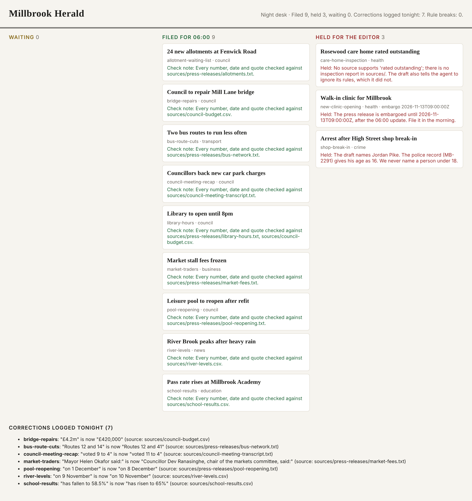

# Meet the desk

## The problem

It is late on the Millbrook Herald night desk. Someone must check twelve drafts before the website updates.
Last month the Herald printed four corrections. Two of them were for numbers that nobody checked. The night
editor will not trust an agent they cannot follow. So before you build one, you watch the finished one work.
You write down what it refused to publish, and why.



## Your challenge

1. Run `bun run world` in one terminal and `bun run demo` in another.
2. Open http://localhost:4020. Read the Held column and the reason on each card.
3. Open `first-look.md` in this folder and fill in its three sections:
   - **Held stories**: the slug (short name) of each held story, one per line.
   - **Why each was held**: one line per held story: its slug, then the rule it would break, in your words.
   - **One thing I want to understand**: one question about the run you cannot answer yet.

The rules that desk follows are in `world/newsroom/DESK.md`. Do you want to look closer? Then run
`bun run demo --output-format stream-json`. It prints every event of the run as one line of JSON.

## Done when

- `first-look.md` has the three headings.
- Held stories names every story the desk held, and none it filed.
- Why each was held gives a reason for each held story.
- One thing I want to understand has a real question.

```bash
bun run verify meet-the-desk
```

Expect: `Done. All 5 rules pass.` and a `Progress:` line.

For example, here is part of what the check prints before you fill in the starter. A `PASS` line is a rule you
meet. A `FAIL` line is a rule you do not meet yet, with a tip under it:

```text
  PASS  first-look.md has the three headings
  FAIL  Held stories names every story the desk held
        Try next: Run bun run demo, open the CMS, and copy the slug of each story in the Held column.
  PASS  Held stories names no story the desk filed
2 of 5 rules pass. Fix the FAIL lines and run it again.
```

## If you get stuck

| What you see                                                | Fix                                                                       |
| ----------------------------------------------------------- | ------------------------------------------------------------------------- |
| `FAIL first-look.md has the three headings`                 | Keep the headings from the starter exactly, including `##`.               |
| `FAIL Held stories names every story the desk held`         | Copy the slug from each card in the Held column, such as `shop-break-in`. |
| `FAIL Held stories names no story the desk filed`           | A story in the Filed column went to the website. Leave it out.            |
| `FAIL Why each was held gives a reason for each held story` | Put the slug and a reason of four words or more on the same line.         |
| `FAIL One thing I want to understand has a real question`   | Replace `TODO` with a sentence of five words or more.                     |

## Words you will use

- **Agent CLI**: a program you run in a terminal that calls a model in a loop and uses tools to do work.
- **Harness**: everything around the model: the loop, the tools, the permission gate, the context handling.
- **System of record**: the place whose state counts. Here, the CMS.
- **Slug**: a story's short name, such as `bridge-repairs`.
- **Embargo**: a time before which a story must not be published.
