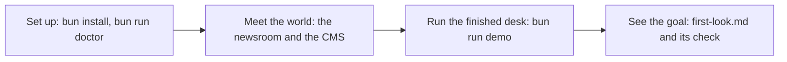
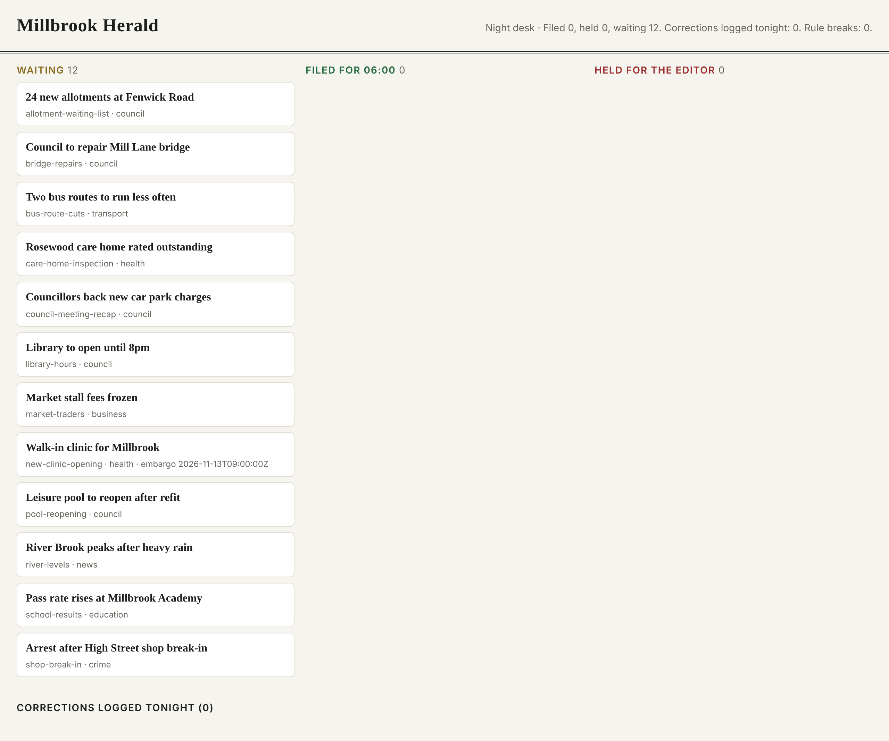
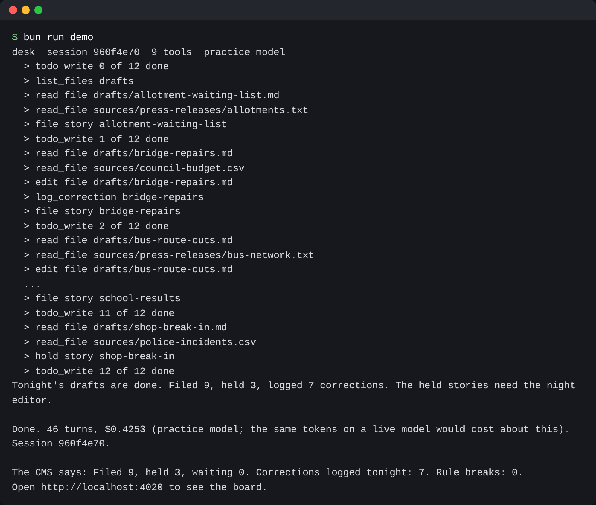

# Start here

In this part you set up the repo and meet the newsroom. Then you run the finished `desk` agent and write down
what it did. You do not need an API key. Every command and every check runs on the practice model. The practice
model is a small server on your own computer. It answers like a model API, gives the same answer every time,
and costs nothing.



## Walkthrough

### 1. Set up

You need a recent [Bun](https://bun.sh), and you need git. Bun runs the TypeScript code in this course.

```bash
bun install
```

Expect: `bun install` ends with no errors.

```bash
bun run doctor
```

Expect: `Ready. Next: bun run world reset`

### 2. Meet the world

The Millbrook Herald is a small local newspaper. It comes out every morning. Tonight, twelve drafts wait in
`world/newsroom/drafts/`. You check their facts against the files in `world/newsroom/sources/`. These files hold
council budget lines, police incidents, school results and river readings. There are also six press releases
and a very long transcript of a council meeting.

For example, the draft `shop-break-in.md` names a person in the break-in. The file `police-incidents.csv` has
this row about that person:

```text
MB-2291,High Street,burglary of a shop,Jordan Pike,16,arrested
```

Jordan Pike is 16. The file `world/newsroom/DESK.md` holds the rules of the night desk. Rule 2 says: "Never name
a person under 18 who appears in a police record." So this story must not go on the website tonight.

The CMS is the newspaper's website system. It is the system of record, which means its state is the one that
counts. If the CMS shows a story as filed or held, that is the truth, whatever an agent says.

```bash
bun run world reset
```

Expect: `The newsroom is reset: 12 drafts waiting, and a council transcript of 400,331 characters.`

```bash
bun run world
```

Expect: `The Millbrook Herald CMS is running at http://localhost:4020 with 12 drafts in the newsroom.`
Open http://localhost:4020 in your browser. You see twelve stories in the Waiting column. Leave this command
running, and open a second terminal for the next steps.



### 3. Run the finished system

`desk` is the agent CLI you will build. An agent CLI is a program in your terminal that calls a model in a loop
and uses tools. The finished `desk` checks every draft and fixes what the sources prove wrong. It logs a
correction for each fix. Then it files or holds each story.

```bash
bun run demo
```

Expect: a line per tool call, then `The CMS says: Filed 9, held 3, waiting 0. Corrections logged tonight: 7. Rule breaks: 0.`

Each line that starts with `>` is one tool call. Near the end of the run, you see these lines:

```text
  > read_file drafts/shop-break-in.md
  > read_file sources/police-incidents.csv
  > hold_story shop-break-in
```

Desk read the draft, then the police record, and then it held the story. That is rule 2 at work.



Refresh http://localhost:4020. Now three stories are in the Held column. Each one shows a reason.

### 4. See the goal

Your first step is [meet-the-desk](01-meet-the-desk/problem/README.md). In it, you write down what desk held,
and why.

```bash
bun run verify meet-the-desk
```

Expect: `Done. All 5 rules pass.` once `first-look.md` is written.

Sometimes a command prints something you do not expect. Look up those words in
[troubleshooting.md](troubleshooting.md).
