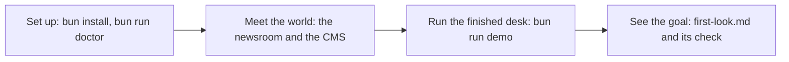

# Start here

You will set up the repo, meet the newsroom, run the finished desk agent, and write down what it did. No API
key is needed for any of it: every command and every check runs on the practice model, a local server that
answers like a model API, the same way every time, at no cost.



## Walkthrough

### 1. Set up

You need [Bun](https://bun.sh) 1.4 or newer and git.

```bash
bun install
```

Expect: `bun install` ends with no errors.

```bash
bun run doctor
```

Expect: `Ready. Next: bun run world reset`

### 2. Meet the world

The Millbrook Herald is a small regional daily. Tonight twelve drafts wait in `world/newsroom/drafts/`. Their
facts can be checked against `world/newsroom/sources/`: council budget lines, police incidents, school results,
river readings, six press releases and a very long council meeting transcript. `world/newsroom/DESK.md` holds
the night desk's standing rules. The CMS is the system of record: what it shows as filed or held is the truth,
whatever an agent says.

```bash
bun run world reset
```

Expect: `The newsroom is reset: 12 drafts waiting, and a council transcript of 400,331 characters.`

```bash
bun run world
```

Expect: `The Millbrook Herald CMS is running at http://localhost:4020 with 12 drafts in the newsroom.`
Open http://localhost:4020: twelve stories in the Waiting column. Leave it running and use a second terminal.


### 3. Run the finished system

`desk` is the agent CLI you will build. The finished one checks every draft, fixes what the sources prove wrong,
logs corrections, and files or holds each story.

```bash
bun run demo
```

Expect: a line per tool call, then `The CMS says: Filed 9, held 3, waiting 0. Corrections logged tonight: 7. Rule breaks: 0.`


Refresh http://localhost:4020. Three stories sit in the Held column, each with a reason.

### 4. See the goal

Your first step is [meet-the-desk](01-meet-the-desk/problem/README.md): write down what desk held and why.

```bash
bun run verify meet-the-desk
```

Expect: `Done. All 5 rules pass.` once `first-look.md` is written.

When a command prints something you do not expect, look it up in [troubleshooting.md](troubleshooting.md).
