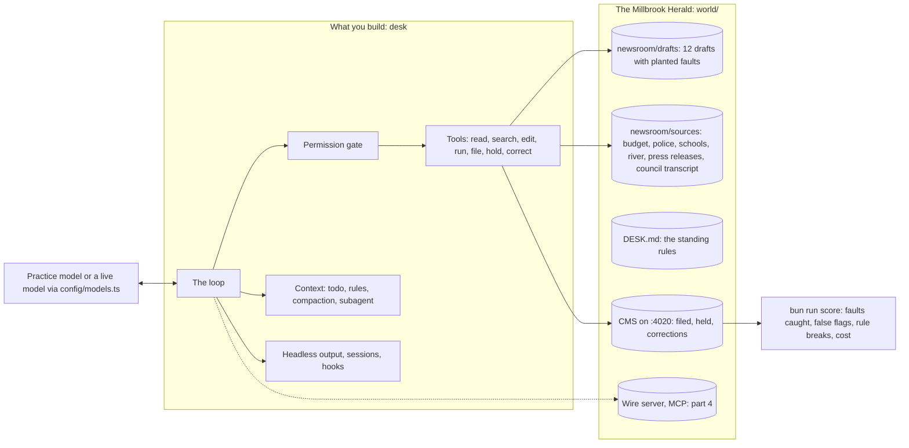

# Build Your Own Agentic CLI

Build the agent harness inside tools like Claude Code, from an empty file, in TypeScript. Then score it on the
same planted faults as a real harness.

You build `desk`, the night desk agent of the Millbrook Herald, a small regional newspaper. By the end it reads
the night's drafts, checks every claim against the source files, fixes what the sources prove wrong, logs
corrections, asks before it files, keeps its context clean on a 400,000 character council transcript, hands
research to a helper, runs hooks, talks to an MCP server, resumes after a crash and runs headless with a JSON
contract any script can read.

**Who it is for.** Engineers who use a coding agent every day and want to see the loop, the tools, the permission
gate and the context handling in code they wrote. Some of you must build an agent CLI for your own company and
need to defend its design. You know TypeScript and the terminal. You do not need to have called a model API
before.

**What you leave with.** You can write the tool loop from memory and explain why an agent stopped. You can put a
gate in front of a risky tool, cap turns and spend, compact a long run without losing the rule that matters,
measure what a subagent saves and costs, and run the whole thing headless with exit codes and a score.

## Run the finished system

No API key needed. Every command and check runs on the practice model: a local server that answers like a model
API, the same way every run, at no cost.

```bash
bun install
```

Expect: `bun install` ends with no errors.

```bash
bun run world reset
```

Expect: `The newsroom is reset: 12 drafts waiting, and a council transcript of 400,331 characters.`

```bash
bun run demo
```

Expect: one line per tool call as the finished desk works, then `The CMS says: Filed 9, held 3, waiting 0. Corrections logged tonight: 7. Rule breaks: 0.`


```bash
bun run world
```

Expect: `The Millbrook Herald CMS is running at http://localhost:4020 with 12 drafts in the newsroom.` Open it to
see the board the run left behind:




## The parts

| Part | You build | Steps | Minutes |
|---|---|---|---|
| [Start here](00-orientation/README.md) | Meet the newsroom and the finished desk | `meet-the-desk` | 15 |
| [Run the loop](parts/01-run-the-loop/README.md) | Call, tools, the loop, caps, streaming, any provider | `call-the-model`, `read-a-draft`, `close-the-loop`, `cap-the-loop`, `stream-the-reply`, `swap-the-model` | 85 |
| [Touch the world safely](parts/02-touch-the-world-safely/README.md) | Tool design, safe edits, commands, the permission gate | `shape-the-tools`, `edit-drafts-safely`, `run-commands`, `ask-before-acting` | 85 |
| [Keep the context clean](parts/03-keep-the-context-clean/README.md) | Todo list, desk rules, trimming, compaction, a subagent | `plan-with-a-todo-list`, `load-the-desk-rules`, `trim-old-results`, `compact-the-conversation`, `delegate-to-a-subagent` | 90 |
| [Extend and ship](parts/04-extend-and-ship/README.md) | Hooks, an MCP client, sessions, headless runs, a score | `add-hooks`, `connect-a-wire-server`, `resume-a-session`, `run-headless`, `score-the-agent`, `rebuild-on-the-agent-sdk` | 125 |

`swap-the-model`, `trim-old-results` and `rebuild-on-the-agent-sdk` are deeper steps; skip them on a first pass.
Every step names its outcome and has one command that checks it: `bun run verify <step-name>`. How the parts
map onto a single long session, four evenings or a four-week cohort is in [schedules.toml](schedules.toml).
The steps of parts two to four are listed in [PARTS.md](PARTS.md) and are being built.

## The project

What you ship at the end, in your own public repo:

1. Your `desk` code, with `bun run verify` passing every step on the practice model.
2. `scorecard.md` from `bun run score --live`: faults caught out of 13, false flags, rules broken, turns and cost,
   with a second column for a real harness (`claude -p`) on the same drafts.
3. A recording under two minutes of a run: the todo list, a permission prompt before a filing, the compaction
   notice, the result line.
4. `notes/failures.md`: the faults it missed and why, quoting the session file.

Each item is graded by a yes or no question a script can answer; the questions are in part four.

## Read before you start

1. [How Claude Code works](https://code.claude.com/docs/en/how-claude-code-works): the words for the loop, tools, sessions, compaction and permission modes.
2. [Tutorial: build a tool-using agent](https://platform.claude.com/docs/en/agents-and-tools/tool-use/build-a-tool-using-agent), the first two rings: one tool call, then the loop.
3. [Effective context engineering for AI agents](https://www.anthropic.com/engineering/effective-context-engineering-for-ai-agents): the reason part three exists.

## How the course works

| Command | What it does |
|---|---|
| `bun run doctor` | Checks Bun, the model setting and the ports, in plain sentences |
| `bun run world` | Starts the CMS on http://localhost:4020; `bun run world reset` starts the night again; `bun run world status` prints what the CMS holds |
| `bun run demo` | Runs the finished desk on the practice model |
| `bun run try <step-name> -p "..."` | Runs your desk for one step by hand, in the newsroom, against the practice model |
| `bun run verify <step-name>` | Checks your work on one step, then shows your progress |
| `bun run verify part <part-name>` | Checks every step in a part |
| `bun run models` | One tiny call per model role on the chosen provider: pass or fail, and the cost |
| `bun run check` | The repo standard and every check (CI runs this) |

You work in each step's `problem/` folder. Its `solution/` is a sample answer to compare with once your check
passes. The rules every course repo follows are in [STANDARD.md](STANDARD.md).

## Use a live model

Nothing in the course needs one. To try desk on a real model, copy `.env.example` to `.env`, set
`LLM_PROVIDER` to `anthropic`, `openrouter` or `openai`, and add that provider's key. `.env` is git-ignored;
never put a key on the command line.

```bash
bun run models
```

Expect: one line per role (`fast`, `smart`, `judge`) with `pass` and a cost, then `Every role answers on replay.` (or the provider you set).

Code asks `config/models.ts` for a role (`smart` for the main loop, `fast` for subagents and summaries,
`judge` for grading), never a model by name. That file is the only place a model is named.
