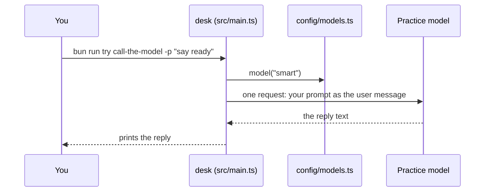
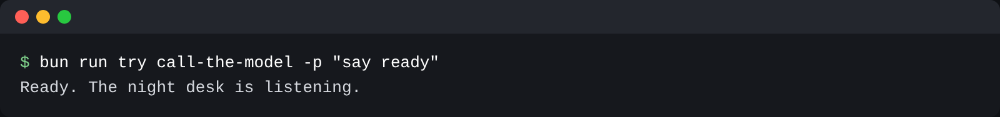

# Call the model

## The problem

The night editor types a question, and nothing answers. Before desk can read a single draft, it must do the
smallest useful thing. It must send a prompt to a model and print the reply. Old tutorials make this look
harder than it is. Many of them also send settings that newer models answer with an error.



## Your challenge

Open `src/main.ts` in this folder. It already reads the text after `-p`. Send that text to the model with
`generateText` from `ai`. Then print the reply.

Ask `config/models.ts` for the model by its role, never by its name. A role says what a call is for. Use
`model("smart")` from `"#models"`. The main loop does the hard thinking, so it uses the smart role. With no
setting, the smart role is the practice model. The practice model is a small server on your computer. It
answers like a real model API, with no key and no cost.

For example, you type `bun run try call-the-model -p "say ready"`. Desk sends the words `say ready` to the
practice model. The model sends back one line of text, and desk prints it:

```bash
bun run try call-the-model -p "say ready"
```

Expect: `Ready. The night desk is listening.` once your desk calls the model.



## Done when

- `bun run try call-the-model -p "say ready"` prints the model's reply and exits with code 0.
- desk sends one request, with your prompt as the user message.
- The request asks for the smart role.
- The request sends no `temperature`.

```bash
bun run verify call-the-model
```

Expect: `Done. All 4 rules pass.` and a `Progress:` line.

## If you get stuck

| What you see                                                      | Fix                                                                                                                         |
| ----------------------------------------------------------------- | --------------------------------------------------------------------------------------------------------------------------- |
| `FAIL It prints the practice model's reply and exits with code 0` | Print the `text` that `generateText` returns. A string you type yourself will not match: each check run gets a fresh reply. |
| `FAIL It sends one request with your prompt as the user message`  | Pass the `-p` text as `prompt`, and call the model once.                                                                    |
| `FAIL It asks config/models.ts for the smart role`                | Use `model("smart")`. The fast role is for cheap side calls, such as summaries.                                             |
| `FAIL It sends no temperature`                                    | Delete `temperature`. Newer models can reject it, and copied examples often set it.                                         |
| `Cannot find module '#models'`                                    | Run `bun install` at the repo root. `#models` is set in the root `package.json`.                                            |

Compare with `../solution/src/main.ts` once your check passes.

## Words you will use

- **Model API**: the web address a program sends a prompt to and gets text back from.
- **Role**: what a model call is for (`smart`, `fast`, `judge`). `config/models.ts` maps a role to a provider and a model.
- **Practice model**: the course's local stand-in for a model API. Same request shape, same answer every run, no key.
- **Prompt**: the text you send. The reply is the text the model sends back.
