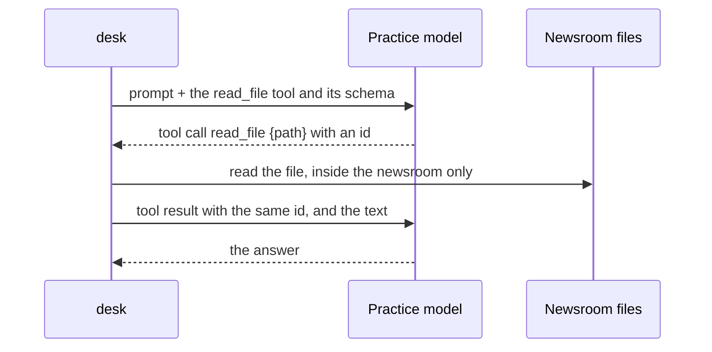

# Read a draft

## The problem

desk can talk, but it cannot see the newsroom. A model never reads a file itself. It asks your program to run a
tool, and your program sends back the result. Each result must match its call, or the model API refuses the
request. A tool must also block files the model should not see.



## Watch it done

For example, the model asks for the tool `read_file` with the input
`{ "path": "drafts/bridge-repairs.md" }` and an id. Your program sends the file's text back with that id.

```bash
bun run try read-a-draft -p "what does the bridge-repairs draft say?"
```

Expect: `I read drafts/bridge-repairs.md. It opens: "Millbrook Council will spend ...` once the tool works.

## Your turn

In `src/main.ts`:

1. Describe a `read_file` tool: a description and a JSON schema with one required string, `path`.
2. Write `readFile(path)`. Resolve the path against the newsroom folder. If the path leaves the folder, refuse
   it, and say so in words the model can read. Do the same when the file does not exist.
3. If the model asked for tools, add one message with role `tool`. It holds a `tool-result` for each call,
   with the call's `toolCallId`. A good read is `{type:"text",value}`. A problem is `{type:"error-text",value}`.
4. Call the model again with the longer message list and print its answer.

## Do it on your work

Ask desk about a file you read at work. Check the answer against it.

## Done when

- The first request offers `read_file` with a schema that needs a string `path`.
- The second request carries the file's text as a tool result with the same id.
- desk prints the model's final answer.
- A path outside the newsroom comes back as an error, and that file is never read.

```bash
bun run verify read-a-draft
```

Expect: `Done. All 4 rules pass.`

## If you get stuck

| What you see                                                                                  | Fix                                                                                                              |
| --------------------------------------------------------------------------------------------- | ---------------------------------------------------------------------------------------------------------------- |
| `FAIL The first request offers a read_file tool whose schema needs a string path`             | Put `read_file: tool({ description, inputSchema: jsonSchema({...}) })` in `tools` and list `path` in `required`. |
| `FAIL The second request sends the file text back as a tool result paired with the call's id` | Send a `tool` message, not a user message. Copy `call.toolCallId` and `call.toolName` into each result.          |
| `FAIL It prints the model's final answer`                                                     | Print the second call's text. The first call's text is often empty when it asks for a tool.                      |
| `FAIL A path outside the newsroom comes back as an error, and the file is not read`           | `relative(root, resolve(root, path))` starts with `..` for a path that escapes. Return an error for it.          |

## Solution

Open the `solution` folder after your check passes.

## Words you will use

- **Tool**: a function your program runs when the model asks. The model sees only its name, description and schema.
- **Schema**: a JSON description of a tool's input. It tells the model what to send.
- **Tool call id**: the label that pairs each result with its call.
- **Path jail**: a check that every path stays inside one folder.
