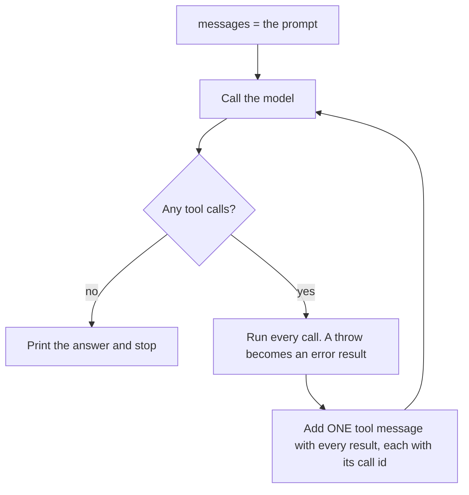

# Close the loop

## The problem

desk reads one file and stops. Real work takes many rounds: list the drafts, read one, read its source, read
the next. The model decides when it is done, not your program. And tools fail: a folder is missing, a path is
wrong. One bad path must not end the whole night's run; the model should hear about it and try something else.



## Your challenge

In `src/main.ts`, turn the single call into a loop:

1. Call the model and add `reply.responseMessages` to `messages`.
2. If `reply.toolCalls` is empty, print `reply.text` and stop.
3. Run every call. Wrap each runner in `try` and `catch`; a throw becomes `{ type: "error-text", value: message }`.
4. Add one message with role `tool` that holds every result from this turn, each with its `toolCallId`.
5. Go back to 1.

This step adds `list_files`. Its runner throws when a folder is missing, on purpose.

```bash
bun run try close-the-loop -p "list the drafts and read the first one"
```

Expect: `I read drafts/allotment-waiting-list.md. It opens: ...` once the loop runs.

## Done when

- desk keeps calling until the model stops asking for tools: four calls on the check's script, then the answer, exit code 0.
- Two tool calls in one turn come back together, each paired with its own call id.
- A tool that throws comes back as an error result, and the loop carries on.
- Every tool call in the history has exactly one result.

```bash
bun run verify close-the-loop
```

Expect: `Done. All 4 rules pass.`

## If you get stuck

| What you see                                                                                        | Fix                                                                                 |
| --------------------------------------------------------------------------------------------------- | ----------------------------------------------------------------------------------- |
| `FAIL It keeps going until the model stops asking for tools: 4 calls, then the answer, exit code 0` | Use `while (true)` and `break` only when there are no tool calls.                   |
| `FAIL Two tool calls in one turn come back together, each paired with its call's id`                | Map over every call in `reply.toolCalls`, not only the first.                       |
| `FAIL A tool that throws comes back as an error result, and the loop carries on`                    | Put `try` and `catch` around the runner, inside the map.                            |
| `FAIL Every tool call in the history has exactly one result`                                        | Push `reply.responseMessages` every turn and never rebuild `messages` from scratch. |

This is the heart of the course. Try it before you open `../solution/src/main.ts`.

## Words you will use

- **Agent loop**: call the model, run its tools, send the results, repeat until it answers with no tool call.
- **Turn**: one call to the model and the tools it asked for.
- **Error result**: a tool result marked as an error, so the model knows the tool failed and why.
