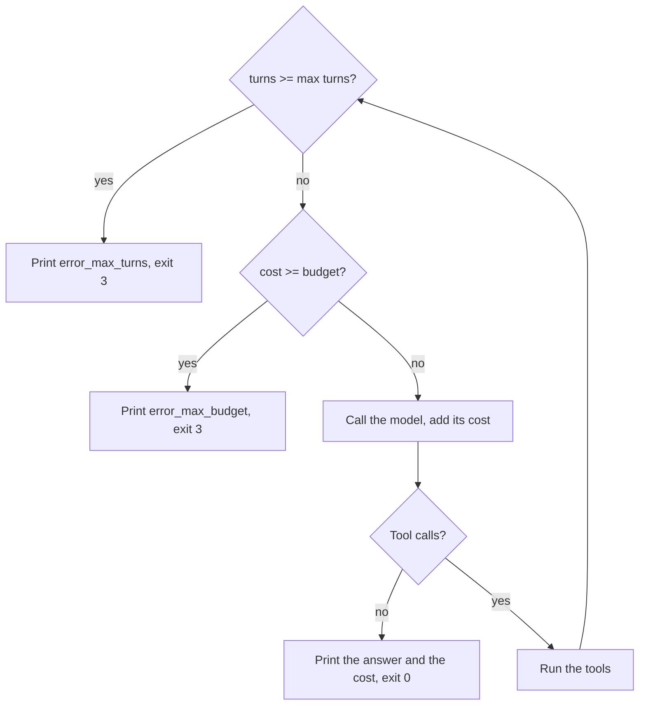

# Cap the loop

## The problem

A loop with no stop rule may never end. A model may keep asking for the same file. That turns into hundreds
of calls and a bill nobody agreed to. The night editor wants two limits on every run: a number of turns, and a
budget in dollars. When desk hits one, it stops and says which. Then a script can tell a stopped run from a
finished one.



## Your challenge

In `src/main.ts`:

1. Read `--max-turns` (default 30) and `--max-budget-usd` (default 2) from the command line.
2. After each call, count the turn and add its cost with `costUsd("smart", reply.usage)` from `"#models"`.
   The price per token lives in `config/models.ts`, so a price change is one edit there.
3. Before each call, stop if `turns >= maxTurns` or `cost >= maxBudgetUsd`. Print `error_max_turns` or
   `error_max_budget` with the turns and the cost as `$0.0000`, and exit with code 3.
4. When the model finishes, print a last line with the turns and the cost.

One call can take the cost past the budget. That is fine, but the next call must never start.

Models charge by the token, a small piece of a word. For example, the smart role costs $2 per million input
tokens and $10 per million output tokens. A call with 10,000 input tokens and 1,000 output tokens costs
$0.02 + $0.01 = $0.03. With a budget of $0.05, the second call takes the cost to $0.06. So desk stops before a
third call.

```bash
bun run try cap-the-loop -p "check every draft" --max-turns 2
```

Expect: `Stopped: error_max_turns after 2 turns, $0.00...` once the cap works.

The solution prints `Stopped: error_max_turns after 2 turns, $0.0014.` and exits with code 3.

## Done when

- With `--max-turns 5` desk stops after exactly 5 model calls.
- At the turn cap it exits with code 3 and prints `error_max_turns`.
- With `--max-budget-usd 0.05` it stops after the call that crosses it, exits 3 and prints `error_max_budget`.
- It prints the cost, priced from `config/models.ts`, within one cent.

```bash
bun run verify cap-the-loop
```

Expect: `Done. All 4 rules pass.`

## If you get stuck

| What you see                                                                                                   | Fix                                                                        |
| -------------------------------------------------------------------------------------------------------------- | -------------------------------------------------------------------------- |
| `FAIL With --max-turns 5 it stops after exactly 5 model calls`                                                 | Check the cap at the top of the loop, before the call, with `>=`.          |
| `FAIL At the turn cap it exits with code 3 and prints error_max_turns`                                         | `process.exit(3)` after printing. Code 0 tells a script the run went fine. |
| `FAIL With --max-budget-usd 0.05 it stops after the call that crosses it, exits 3 and prints error_max_budget` | Add the cost after every call and compare before the next one.             |
| `FAIL It prints the cost, priced from config/models.ts, within one cent`                                       | Use `costUsd` from `"#models"` and print `$` with the number.              |

## Words you will use

- **Cap**: a limit that stops the loop: turns or dollars.
- **Exit code**: the number a program returns when it ends. 0 means success; desk uses 3 for "a cap stopped me".
- **Usage**: the input and output token counts the model API returns with every reply. Cost is usage times price.
