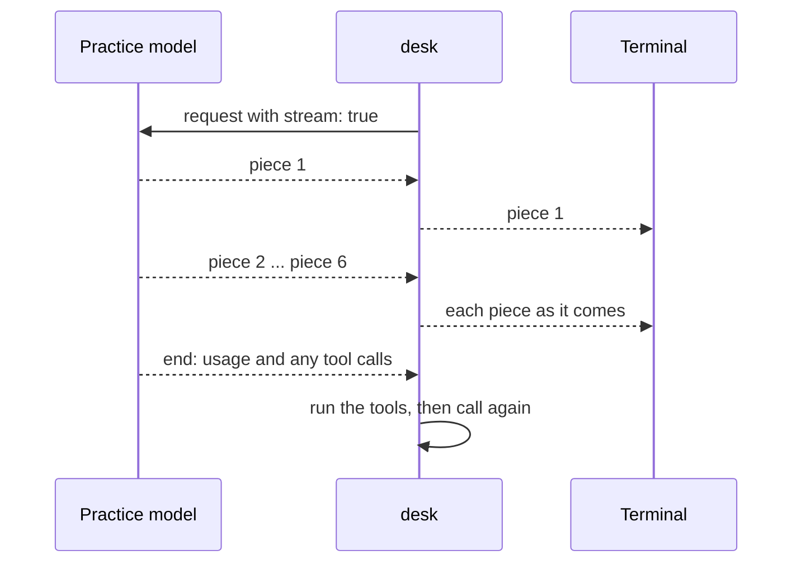

# Stream the reply

## The problem

A long answer takes time. While it comes, the night editor looks at an empty terminal. Is the model slow, or
is it stuck? Nobody can tell. A model API can send its reply in small pieces while it writes. That is called a
stream. desk should print each piece as soon as it arrives. It should print the whole reply once. And it should
still run tools when the reply asks for them.



## Your challenge

In `src/main.ts`, replace `generateText` with `streamText`:

1. `streamText` returns at once. Loop over `reply.textStream` with `for await`. Write each piece with
   `process.stdout.write`.
2. After the stream ends, `await reply.usage`, `await reply.responseMessages` and `await reply.toolCalls`.
   With `streamText`, these are promises. A promise is a value that arrives later.
3. Do not print `reply.text` again at the end. It is already on screen.

```bash
bun run try stream-the-reply -p "what does the river-levels draft say?"
```

Expect: the answer appears a few words at a time, then `Done. 2 turns, $0.00...`.

For example, the solution prints these three lines. Each line arrives in small pieces, not all at once:

```text
I will read drafts/river-levels.md.
I read drafts/river-levels.md. It opens: "The River Brook peaked at 3.4 metres at Brook Bridge on 9 November after heavy rain."
Done. 2 turns, $0.0016.
```


## Done when

- Every model call asks for a stream.
- The start of the reply is on screen well before its end arrives.
- The whole reply is printed exactly once.
- Tools still work: the tool result goes back, and the run ends with code 0.

```bash
bun run verify stream-the-reply
```

Expect: `Done. All 4 rules pass.`

## If you get stuck

| What you see                                                                    | Fix                                                                      |
| ------------------------------------------------------------------------------- | ------------------------------------------------------------------------ |
| `FAIL Every model call asks for a stream`                                       | Call `streamText`, not `generateText`.                                   |
| `FAIL The start of the reply is on screen well before its end arrives`          | Write inside the `for await` loop. `await reply.text` waits for the end. |
| `FAIL The whole reply is printed exactly once`                                  | Remove the extra `console.log` of the full text.                         |
| `FAIL Tools still work: the tool result goes back and the run ends with code 0` | `await reply.toolCalls` after the stream and run them as before.         |

## Words you will use

- **Stream**: a reply sent in pieces while the model writes it, instead of all at the end.
- **Server-sent events**: the format the pieces travel in over HTTP. The AI SDK reads it for you.
- **Promise**: a value that arrives later. `await` waits for it.
