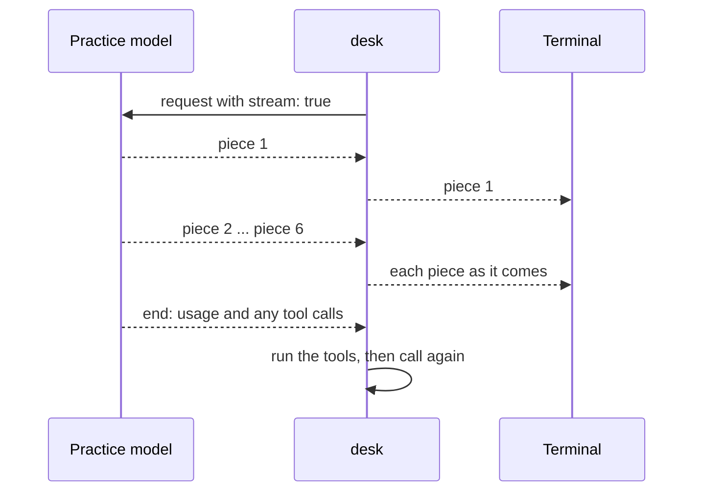
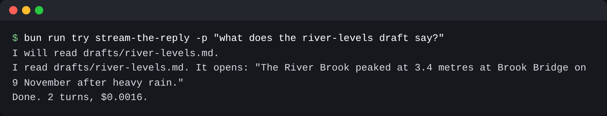

# Stream the reply

## The problem

A long answer takes time, and the night editor sees an empty terminal. Is the model slow, or stuck? A model API
can send its reply in small pieces while it writes. That is called a stream. desk should print each piece as it
arrives, print the whole reply once, and still run tools.



## Watch it done

For example, the solution prints three lines. They arrive in small pieces:

```text
I will read drafts/river-levels.md.
I read drafts/river-levels.md. It opens: "The River Brook peaked at 3.4 metres at Brook Bridge on the ninth after heavy rain."
Done. 2 turns, $0.0016.
```

```bash
bun run try stream-the-reply -p "what does the river-levels draft say?"
```

Expect: the answer appears a few words at a time, then `Done. 2 turns, $0.00...`.



## Your turn

In `src/main.ts`, replace `generateText` with `streamText`:

1. `streamText` returns at once. Loop over `reply.textStream` with `for await`. Write each piece with
   `process.stdout.write`.
2. After the stream ends, `await reply.usage`, `await reply.responseMessages` and `await reply.toolCalls`.
   With `streamText`, these are promises.
3. Do not print `reply.text` again at the end. It is already on screen.

4. A busy service answers 503 or 429. Pass `maxRetries: 0` to `streamText`, catch the
   error, read `error.statusCode`, print a `Retrying` line with the wait in ms, wait, and call again, twice as long each time. Give
   up after three retries with a `Stopped:` line and exit 1. Never retry a 400. `DESK_RETRY_MS` sets the first wait.

## Do it on your work

Pick a long answer at work. Say whether it should stream.

## Done when

- Every model call asks for a stream.
- The start of the reply is on screen well before its end arrives.
- The whole reply is printed exactly once.
- Tools still work: the tool result goes back, and the run ends with code 0.
- A busy service (503) is retried with a printed wait, and the run then finishes.
- A service that never recovers is tried 4 times in all, then desk stops with exit 1.
- Our own mistake (400) is not retried.

```bash
bun run verify stream-the-reply
```

Expect: `Done. All 7 rules pass.`

## If you get stuck

| What you see                                                                    | Fix                                                                      |
| ------------------------------------------------------------------------------- | ------------------------------------------------------------------------ |
| `FAIL Every model call asks for a stream`                                       | Call `streamText`, not `generateText`.                                   |
| `FAIL The start of the reply is on screen well before its end arrives`          | Write inside the `for await` loop. `await reply.text` waits for the end. |
| `FAIL The whole reply is printed exactly once`                                  | Remove the extra `console.log` of the full text.                         |
| `FAIL A busy service (503) is retried ...`                                      | Catch the error and read `error.statusCode`. Print the wait, then loop.  |
| `FAIL Tools still work: the tool result goes back and the run ends with code 0` | `await reply.toolCalls` after the stream and run them as before.         |

## Solution

Open the `solution` folder after your check passes.

## Words you will use

- **Stream**: a reply sent in pieces as the model writes it.
- **Promise**: a value that arrives later. `await` waits for it.
