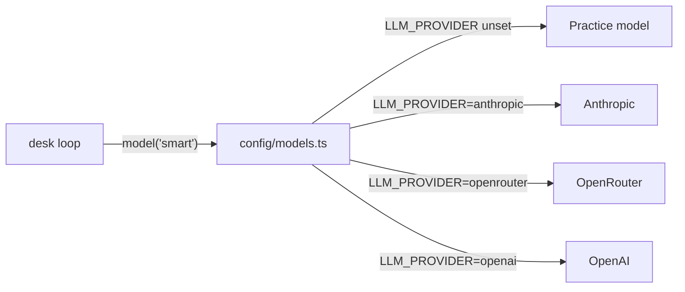

# Swap the model

## The problem

A provider is a company or server that runs models behind an API. The Herald's owners want a price from a
second provider before they sign a contract. But desk is tied to one provider, and its model name is typed into
the code. Nobody can run desk elsewhere without changing the loop.



## Watch it done

For example, the starter has these two lines:

```ts
import { createAnthropic } from "@ai-sdk/anthropic";
const smartModel = anthropic("practice-smart");
```

Once your desk asks `config/models.ts` for its model, this command runs it on a second provider:

```bash
LLM_PROVIDER=openrouter OPENROUTER_API_KEY=practice OPENROUTER_BASE_URL=http://localhost:4010/v1 bun run try swap-the-model -p "what does the library-hours draft say?"
```

Expect: `I read drafts/library-hours.md. It opens: ...` once desk asks `config/models.ts` for its model.

## Your turn

Open `src/main.ts`. It imports a provider package. It builds a model with a name typed into the code.

1. Delete the provider import and the model name.
2. Import `model` and `costUsd` from `"#models"` and call `model("smart")`.
3. Run the same desk on a second provider. You change one setting, not the code. The check sends requests in
   OpenRouter's shape to the practice model, so it needs no key. Start the practice model in one terminal:

```bash
bun run practice-model
```

Expect: `The practice model is running at http://localhost:4010.` Leave it running. Then run the command from
the Watch it done section in a second terminal.

## Do it on your work

Write down one place at work where a name or price is typed in more than one spot. Say where the one setting could live instead.

## Done when

- With `LLM_PROVIDER=openrouter` every call goes out in OpenRouter's shape and the run finishes.
- On the second provider the tool result still goes back, paired with its call.
- No file in `src/` imports a provider package or names a model.
- With no setting, desk still runs on the practice model.

```bash
bun run verify swap-the-model
```

Expect: `Done. All 4 rules pass.`

## If you get stuck

| What you see                                                                                       | Fix                                                                                             |
| -------------------------------------------------------------------------------------------------- | ----------------------------------------------------------------------------------------------- |
| `FAIL With LLM_PROVIDER=openrouter every call goes out in OpenRouter's shape and the run finishes` | `model("smart")` from `"#models"` reads `LLM_PROVIDER`. A provider you build yourself does not. |
| `FAIL On the second provider the tool result still goes back, paired with its call`                | Keep the loop as it was; only the source of the model changes.                                  |
| `FAIL No file in src imports a provider package or names a model`                                  | Search `src/` for `@ai-sdk/`, `@openrouter/` and `practice-` and remove them.                   |
| `FAIL With no setting it still runs on the practice model`                                         | Unset `LLM_PROVIDER` in your terminal, or leave it empty in `.env`.                             |

## Solution

Open the `solution` folder after your check passes.

## Words you will use

- **Provider**: a company or server that runs models behind an API: Anthropic, OpenRouter, OpenAI, a local Ollama.
- **Provider package**: the AI SDK adapter that speaks one provider's request shape.
- **Request shape**: how a provider wants the prompt, tools and results laid out. The AI SDK converts for you.
