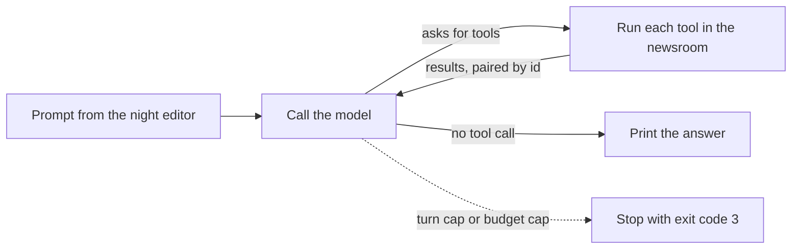

# Run the loop

## The problem

Twelve drafts wait on the Millbrook Herald night desk. The night editor wants an agent that reads them, checks
them and files them. First, the agent needs a loop. The loop is the center of every agent harness. It calls the
model and runs the tools the model asks for. It sends the results back to the model. And it stops at the
right time.

For example, here are five lines from the finished desk at work on the river story. Each line is one tool
call that the model asked for:

```text
  > read_file drafts/river-levels.md
  > read_file sources/river-levels.csv
  > edit_file drafts/river-levels.md
  > log_correction river-levels
  > file_story river-levels
```

Between those lines, the loop sends each result back, and the model picks the next step. When the model asks
for no more tools, the loop ends.

If you get the loop wrong, the agent is useless or costs too much. Here are three ways it goes wrong:

- It stops after the first tool call and says nothing.
- It sends a result the model cannot match to its call, and the API refuses the request.
- It never stops. It keeps spending money on a question it answered long ago.

## Why it matters

The loop is small, and it is enough. Anthropic built a coding agent from a model in a loop with two tools: a
shell and a file editor. They let it "sample until the model decides that it is finished". It scored 49% on
SWE-bench Verified, a public test of coding agents. The best score before it was 45%
([Anthropic, read today](https://www.anthropic.com/engineering/swe-bench-sonnet)). Everything later in this
course is built around this loop: permissions, compaction, helper agents and hooks.



## Steps

| Step               | Minutes | You build                                                              | The check reads                                                                        |
| ------------------ | ------- | ---------------------------------------------------------------------- | -------------------------------------------------------------------------------------- |
| `call-the-model`   | 10      | One prompt to the smart role, the reply printed                        | The request the practice model got: the prompt, the role, no temperature               |
| `read-a-draft`     | 15      | A `read_file` tool, its schema, and one round trip                     | The tool schema, the result paired to its call id, a path outside the newsroom refused |
| `close-the-loop`   | 20      | The `while` loop, with errors sent back, not thrown                    | Four calls, two results in one message, an error result, every call paired once        |
| `cap-the-loop`     | 10      | `--max-turns` and `--max-budget-usd`, the cost from `config/models.ts` | The number of calls, exit code 3, the cost printed within one cent                     |
| `stream-the-reply` | 15      | Streaming text to the terminal as it arrives                           | `stream: true`, the time between the first and last piece on screen                    |
| `swap-the-model`   | 15      | The same loop on a second provider with one setting                    | Requests in OpenRouter's shape, no provider import in `src/`                           |

Every step starts from `problem/src/main.ts`. That file is the answer to the step before, with the new part
marked `TODO`. You work in the `problem/` folder of the step. `bun run try <step-name> -p "..."` runs your desk
by hand in the newsroom, on the practice model. `bun run verify <step-name>` checks your work.

## Walkthrough

Here is the whole part from start to finish. Each check runs your `src/main.ts` three times. Every run gets a
fresh copy of the newsroom and the practice model. Then the check reads what the model received.

```bash
bun run try call-the-model solution -p "say ready"
```

Expect: `Ready. The night desk is listening.`

```bash
bun run verify call-the-model
```

Expect: `Done. All 4 rules pass.` once your desk calls the model.

```bash
bun run verify read-a-draft
```

Expect: `Done. All 4 rules pass.` once `read_file` works and refuses paths outside the newsroom.

```bash
bun run verify close-the-loop
```

Expect: `Done. All 4 rules pass.` once the loop runs until the model stops asking for tools.

```bash
bun run verify cap-the-loop
```

Expect: `Done. All 4 rules pass.` once both caps stop the loop with exit code 3.

```bash
bun run verify stream-the-reply
```

Expect: `Done. All 4 rules pass.` once the reply prints as it streams.

```bash
bun run verify swap-the-model
```

Expect: `Done. All 4 rules pass.` once desk runs on OpenRouter's shape with no code change.

```bash
bun run verify part run-the-loop
```

Expect: `Part run-the-loop is done: 6/6 steps pass.`

## Read

- [How Claude Code works](https://code.claude.com/docs/en/how-claude-code-works): the words for the loop, tools and sessions.
- [Tutorial: build a tool-using agent](https://platform.claude.com/docs/en/agents-and-tools/tool-use/build-a-tool-using-agent): the same loop, ring by ring.
- [How the agent loop works](https://code.claude.com/docs/en/agent-sdk/agent-loop): turns, `maxTurns`, `maxBudgetUsd` and result subtypes, the names `cap-the-loop` uses.
