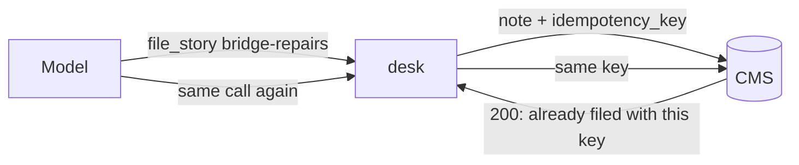
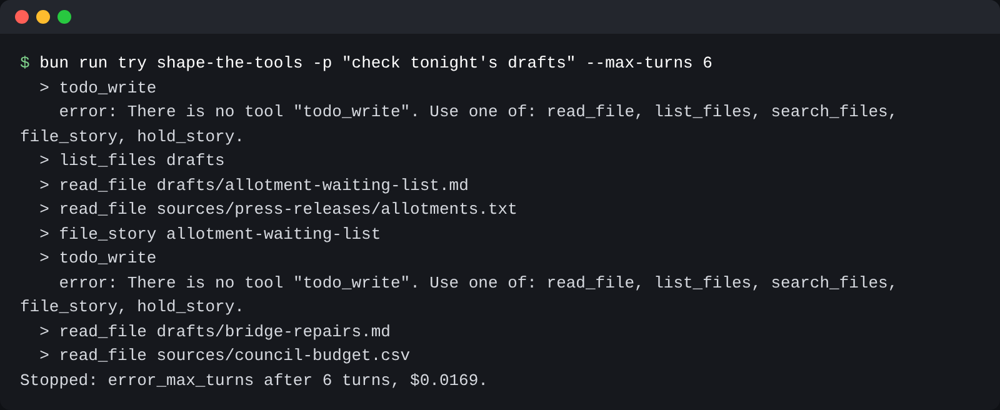

# Shape the tools

## The problem

The model acts only through tools. It reads each tool's schema and every error. So a tool is a contract, errors
included. Right now desk has two tools. It cannot search the sources or file a story. Its errors are not
helpful. A model can also send the same `file_story` call twice. Without care, the story goes out twice.



## Watch it done

For example, the model asks `list_files` for `drafts/bridge-repairs.md`, which is a file. desk sends back
`ENOTDIR: not a directory, scandir ...`. The model cannot tell what to do next.

A good error for that call reads:

```text
"drafts/bridge-repairs.md" is not a folder. Use read_file for a file, or list_files with path "." to see the folders.
```

```bash
bun run try shape-the-tools solution -p "check tonight's drafts" --max-turns 6
```

Expect: lines such as a `file_story` line, then `Stopped: error_max_turns`.

Lines such as `error: There is no tool "todo_write"` are fine.



## Your turn

This step starts from your Run the loop desk. `src/main.ts` holds the loop. You work in `src/tools.ts`, which
holds the tools.

1. Add `search_files(pattern, path)`. It looks in one file, or in every file of a folder. It returns each
   match as `path:line: text`.
2. Add `file_story(slug, note)` and `hold_story(slug, reason)`. They POST to the CMS at
   `process.env.CMS_URL`. Read the CMS API list at the top of `world/cms/server.ts`.
3. Give every schema `required` with every field, and `additionalProperties: false`. Then the model cannot
   invent a field.
4. Make every error name a tool the model can call next.
5. Send an `idempotency_key` with each filing: one id per run, plus the slug. An idempotency key is a label
   that makes a repeated request safe. The CMS files a story once per key.

Run `bun run world reset` first. A `try` run changes the newsroom.

## Do it on your work

Name a tool you would give an assistant at work. Write its required fields.

## Done when

- desk offers read_file, list_files, search_files, file_story and hold_story.
- Every tool schema lists its fields as required and sets `additionalProperties` to false.
- search_files finds a planted line and says which file it is in.
- Each planted bad call comes back as an error that names a tool to try next.
- Two identical file_story calls file the story once: the CMS answers both with 200.

```bash
bun run verify shape-the-tools
```

Expect: `Done. All 5 rules pass.`

## If you get stuck

| What you see                                                               | Fix                                                               |
| -------------------------------------------------------------------------- | ----------------------------------------------------------------- |
| `FAIL  Every tool schema lists its fields as required ...`                 | Write one helper that builds every schema the same strict way.    |
| `FAIL  Each planted bad call comes back as an error that names a tool ...` | Check for the problem before Node does, and throw your own error. |
| `FAIL  Two identical file_story calls file the story once ...`             | Make the id once, at the top of the file, not inside `fileStory`. |

## Solution

Open the `solution` folder after your check passes.

## Words you will use

- **Schema**: the shape of a tool's input, written as JSON Schema. The model reads it to build a call.
- **Slug**: the short name of a story, such as `bridge-repairs`.
