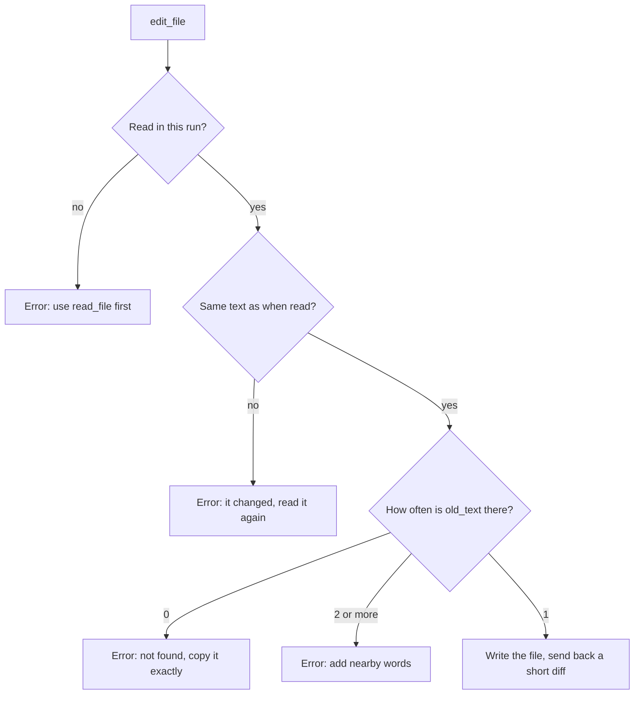
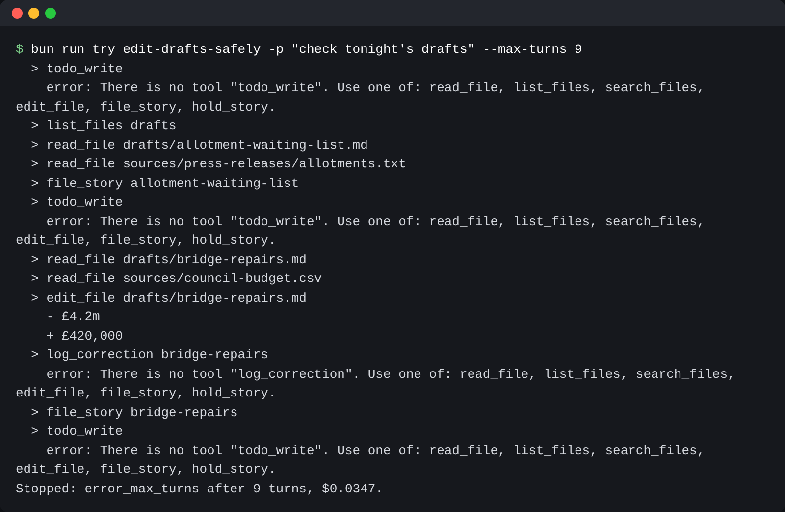

# Edit drafts safely

## The problem

Last month a style fix wiped out a whole paragraph, and nobody saw it until morning. An editing tool must
change only what the model means to change.

For example, the draft `drafts/river-levels.md` says the river peaked "on the ninth". The source
`sources/river-levels.csv` shows the peak on the tenth. The fix is one small swap: the old text
"on the ninth" becomes the new text "on the tenth".

Four things can go wrong:

- The old text is not in the file. The model copied it wrong.
- The old text is in the file twice. `metres` is in the river draft two times, so which one?
- The model never read the file, so it guesses.
- A reporter changed the file after the model read it, so its copy is out of date.

In each case, desk must refuse and say why.



## Your challenge

In `src/tools.ts`:

1. Add the `edit_file(path, old_text, new_text)` tool and its runner.
2. In `readFile`, save the text you read in a `Map` from the full path to the text.
3. In `editFile`, refuse with a clear error in each of the four cases above.
4. Otherwise replace that one piece, save the new text in the `Map`, and return a short diff.

`src/main.ts` already prints the diff of every edit call.

Tip: split the text on `old_text`, then join the two pieces with `new_text`. `text.replace()` treats `$&` in
the new text as a code.

Run `bun run world reset` first. A `try` run changes the newsroom.

```bash
bun run try edit-drafts-safely solution -p "check tonight's drafts" --max-turns 9
```

Expect: an `edit_file drafts/bridge-repairs.md` line with `- £4.2m` and `+ £420,000` under it.



## Done when

- The planted fix lands, and every other byte of the draft stays the same.
- An edit to a file desk has not read comes back as an error.
- An edit whose old text is not in the file comes back as an error.
- An edit whose old text is in the file twice comes back as an error.
- An edit to a file that changed since desk read it comes back as an error.
- A good edit sends back a short diff with the old and new text, not the whole file.

```bash
bun run verify edit-drafts-safely
```

Expect: `Done. All 6 rules pass.`

## If you get stuck

| What you see                                                  | Fix                                                     |
| ------------------------------------------------------------- | ------------------------------------------------------- |
| `FAIL  The planted fix lands, and every other byte ...`       | Replace one piece only. Never use `replaceAll` here.    |
| `FAIL  An edit to a file that changed since desk read it ...` | Read the file again and compare it with the saved text. |
| `FAIL  A good edit sends back a short diff ...`               | Return two lines, `- old` and `+ new`, not the file.    |

## Words you will use

- **Diff**: a short view of a change, with `-` before removed text and `+` before added text.
- **Exact replace**: an edit that names the old text word for word.
