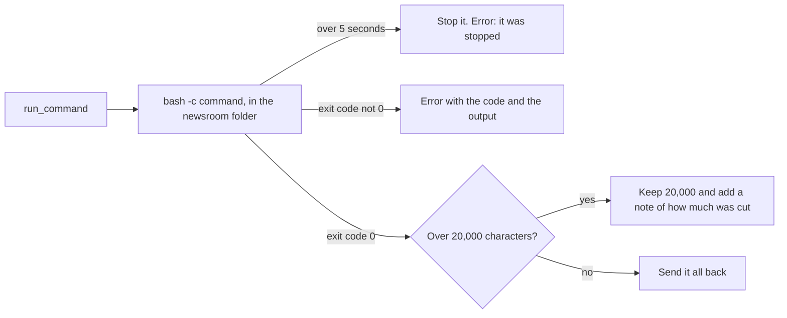

# Run commands

## The problem

Some checks need a command. But a shell is the most powerful tool, and three things go wrong fast.

- A command never ends, such as `sleep 60` or `tail -f`. The run waits.
- A command prints too much. That fills the model's context window.
- A failed command looks like success. The model trusts a wrong answer.



## Watch it done

For example, the school draft says the pass rate "has fallen to 58.5%". To check it, desk adds up a column of
`sources/school-results.csv`. One `awk` command does that:

```text
awk -F, 'NR > 1 { total += $4 } END { print total }' sources/school-results.csv
259
```

`cat` on the council transcript prints about 400,000 characters. That costs money on every turn after.

## Your turn

So desk needs a `run_command` tool. In `src/tools.ts`:

1. Add the `run_command(command)` tool and its runner.
2. Run the command with `Bun.spawnSync(["bash", "-c", command], { cwd: root, timeout: 5000 })`.
3. When `exitedDueToTimeout` is true, throw an error that says the command was stopped.
4. Join stdout and stderr. Over 20,000 characters, keep the first 20,000 and add a note with the number of
   characters you cut.
5. When the exit code is not 0, throw an error with the code and what the command printed.

The command runs in the newsroom folder. That keeps paths short, but it is not a sandbox. A command can
still `cd ..` and touch other files. The next step adds a permission gate.

```bash
bun run verify run-commands
```

Expect: `Done. All 5 rules pass.` One rule waits for a `sleep 60` to be stopped, so the check takes about 20
seconds.

## Do it on your work

Pick a command you run at work. Decide how long it may run.

## Done when

- A command that hangs is stopped within 10 seconds and comes back as an error.
- Output over 20,000 characters is cut, with a note of how many characters were cut.
- The awk sum over `sources/school-results.csv` comes back right.
- Commands run in the newsroom folder.
- A command that fails comes back as an error with what it printed.

## If you get stuck

| What you see                                                  | Fix                                                                        |
| ------------------------------------------------------------- | -------------------------------------------------------------------------- |
| `FAIL  A command that hangs is stopped within 10 seconds ...` | Pass `timeout: 5000` to `Bun.spawnSync`, then check `exitedDueToTimeout`.  |
| `FAIL  Output over 20,000 characters is cut ...`              | The note holds `output.length - 20000`, the number you cut.                |
| `FAIL  The awk sum over sources/school-results.csv ...`       | Send back stdout as it is. The check plants a new school row on every run. |
| `FAIL  A command that fails comes back as an error ...`       | Check `exitCode` after the timeout, and throw when it is not 0.            |

## Solution

Open the `solution` folder after your check passes.

## Words you will use

- **Timeout**: the longest time desk lets a command run before it stops it.
- **Exit code**: the number a command ends with. 0 means it worked. Anything else means it failed.
- **Context window**: what the model reads on one call.
