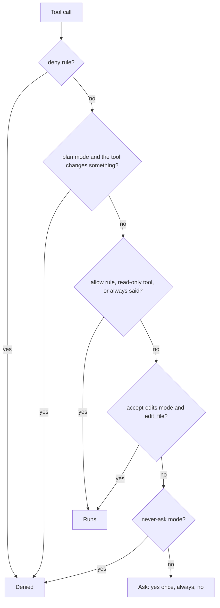
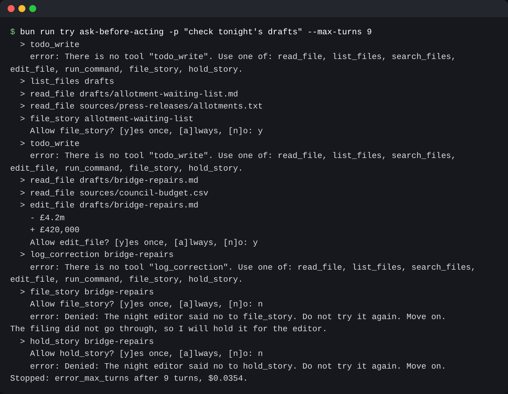

# Ask before acting

## The problem

desk can now edit drafts, run commands and file stories, and nothing stops it. Asking about every call does not
help. Anthropic reports that people "accept 93% of" Claude Code's permission prompts anyway. So a good
gate allows safe work, denies what must never happen, and asks only about the rest.



## Watch it done

For example, with no rules, desk asks before it files a story:

```text
  > file_story bridge-repairs
    Allow file_story? [y]es once, [a]lways, [n]o: n
    error: Denied: The night editor said no to file_story. Do not try it again. Move on.
```

A "no" goes back to the model as an error, so it can hold the story.

```bash
bun run try ask-before-acting solution -p "check tonight's drafts" --max-turns 9
```

Expect: `Allow file_story?` and desk waits for your answer.



## Your turn

1. In `src/main.ts`, read `--permission-mode` (default `ask`) and stop with exit code 1 when it is not
   one of `ask`, `accept-edits`, `plan` or `never-ask`.
2. Load the rules from `desk.config.json` with `loadRules`. They look like this:

```json
{ "permissions": { "allow": ["edit_file"], "ask": [], "deny": ["run_command"] } }
```

3. Before a tool runs, call `decide()`. When it says no, throw an error that starts with `Denied:`.
4. In `src/permissions.ts`, write `decide()` in the order of the diagram. The first answer wins.
5. To ask, call `prompt()`. It reads one line from stdin.
   Treat `null` as no. "Always" lasts until the run ends.

The order is the lesson. A deny rule must win over an allow rule. Plan mode must win over "always".

Run `bun run world reset` first. A `try` run changes the newsroom.

## Do it on your work

Name one action you would never let an assistant take. Make it a deny rule.

## Done when

- Answered n, the CMS is unchanged and the model hears the call was denied.
- Read-only tools run without a prompt.
- y files the story once, and a covers later calls to the same tool.
- A deny rule in desk.config.json beats an allow rule for the same tool.
- Plan mode leaves the files and the CMS untouched, and reads still work.
- never-ask mode denies every call that would prompt.
- accept-edits mode runs edit_file but still asks before filing.

```bash
bun run verify ask-before-acting
```

Expect: `Done. All 7 rules pass.`

## If you get stuck

| What you see                                                    | Fix                                                                      |
| --------------------------------------------------------------- | ------------------------------------------------------------------------ |
| `FAIL  A deny rule in desk.config.json beats an allow rule ...` | Move the deny check to the very top of `decide()`.                       |
| `FAIL  Plan mode leaves the files and the CMS untouched ...`    | Plan mode denies every tool that is not read-only, not only `edit_file`. |
| `FAIL  never-ask mode denies every call that would prompt`      | Deny just before you would call `prompt()`.                              |

## Solution

Open the `solution` folder after your check passes.

## Words you will use

- **Permission mode**: one setting that changes what the gate does.
- **Rule**: a tool name in the `allow`, `ask` or `deny` list of `desk.config.json`.
- **Read-only tool**: a tool that only looks, such as `read_file`.
