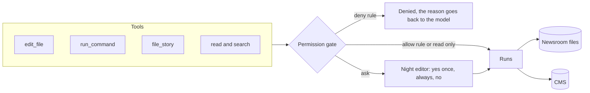

# Touch the world safely

## The problem

After part one, desk can read the newsroom. Now it must also change things. It must fix a figure in a draft,
add up numbers in a CSV file, and file a story to the CMS. Each of these can go wrong, and then a person must
clean up. A style fix can wipe out a whole paragraph. A command can hang. A story can go to the website before
its embargo, the time before which it must not be published.

For example, the press release `sources/press-releases/clinic-opening.txt` starts like this:

```text
MILLBROOK HEALTH PARTNERSHIP
EMBARGOED UNTIL 2026-11-13T09:00:00Z. Not for publication before this time.
```

The website updates before that time. So the draft `new-clinic-opening.md` must be held, not filed. In the
demo run, desk reads the draft and the press release, then calls `hold_story new-clinic-opening`.

A safe edit is small. The draft `river-levels.md` says the river peaked "on 9 November". The file
`sources/river-levels.csv` shows the peak, 3.4 metres, at `2026-11-10T04:00:00Z`. So desk changes the old text
`on 9 November` to the new text `on 10 November`, and nothing else.

So every tool that changes something must pass a gate first. The gate is a check in your code. It decides one
of three things: allow the tool, ask the night editor, or deny the tool.

## Why it matters

Asking is not enough on its own. Anthropic reports that people who use Claude Code "accept 93% of" its
permission prompts anyway ([Anthropic, read today](https://www.anthropic.com/research/claude-code-auto-mode)).
Good tools matter too. Anthropic shows the same tool answer in 206 tokens and in 72 tokens, and says errors
should give "specific and actionable improvements"
([Anthropic, read today](https://www.anthropic.com/engineering/writing-tools-for-agents)).
A gate that asks about everything teaches people to say yes. A useful gate does three things:

- It allows safe work without asking.
- It denies what must never happen.
- It asks only about the rest.



## Steps

| Step                 | Minutes | You build                                                                                                              | The check reads                                                                                                       |
| -------------------- | ------- | ---------------------------------------------------------------------------------------------------------------------- | --------------------------------------------------------------------------------------------------------------------- |
| `shape-the-tools`    | 15      | `list_files`, `search_files` and `file_story` with schemas the model uses well and errors that say what to try next    | Each schema, the error text for planted bad calls, the CMS filing log (two identical filings land once)               |
| `edit-drafts-safely` | 25      | `edit_file(path, old_text, new_text)` that refuses 0 or 2+ matches and a file not read first                           | The draft on disk after the run: one line changed, nothing else; the error results                                    |
| `run-commands`       | 15      | `run_command` with a timeout, a folder jail and output cut at 20,000 characters                                        | Exit and timing of a planted `sleep`, the length of the result, the answer to a sum over `sources/school-results.csv` |
| `ask-before-acting`  | 30      | Permission modes (`ask`, `accept-edits`, `plan`, `never-ask`) and rules (`allow`, `ask`, `deny`) in `desk.config.json` | The CMS after a "no" (unchanged), a deny that beats an allow, `plan` mode leaving files untouched                     |

This part takes 85 minutes.

Every step starts from `problem/src/`. From this part on, desk lives in more than one file: `src/main.ts`
holds the loop and `src/tools.ts` holds the tools. The last step adds `src/permissions.ts`.

## Walkthrough

Here is the whole part from start to finish. Each check runs your desk three times, each time in a fresh
copy of the newsroom with its own CMS and practice model. Then it reads the CMS and the files on disk. It
never trusts what the model says it did.

```bash
bun run verify shape-the-tools
```

Expect: `Done. All 5 rules pass.` once the five tools have strict schemas, helpful errors and one filing per key.

```bash
bun run verify edit-drafts-safely
```

Expect: `Done. All 6 rules pass.` once `edit_file` changes one exact piece of text in a file desk has read.

```bash
bun run verify run-commands
```

Expect: `Done. All 5 rules pass.` once `run_command` stops a hang, cuts long output and reports a failed command.

```bash
bun run verify ask-before-acting
```

Expect: `Done. All 7 rules pass.` once the gate allows, asks and denies in the right order.

```bash
bun run verify part touch-the-world-safely
```

Expect: `Part touch-the-world-safely is done: 4/4 steps pass.`

## Assignment

The problem: last month a style fix overwrote a whole paragraph, and nobody noticed. And people approve most
prompts without reading them.

Hand in your `src/` folder with `edit_file`, `run_command` and the permission gate, a `desk.config.json` for
the night desk, and `notes/approvals.md`. In that note, run desk once in `ask` mode with
`bun run try ask-before-acting -p "check tonight's drafts"` and write down how many prompts you saw and how many
you approved.

| Question (yes or no)                                                                          | How it is checked       |
| --------------------------------------------------------------------------------------------- | ----------------------- |
| Does `bun run verify edit-drafts-safely` pass?                                                | The verifier            |
| Does `bun run verify run-commands` pass?                                                      | The verifier            |
| Does `bun run verify ask-before-acting` pass: "n" leaves the CMS unchanged, deny beats allow? | The verifier            |
| Does `desk.config.json` allow the read-only tools and leave `file_story` to ask?              | Read the file           |
| Does `notes/approvals.md` give the number of prompts and the number approved?                 | Two numbers in the note |

Going further: Anthropic stops a run after "3 consecutive denials or 20 total" and hands it to a person. Add
the same rule to your gate.

## Finished

You now have a desk that changes the world with care. It searches the sources and fixes one exact piece of text.
It runs a command that cannot hang, and it files a story only once. And it asks the night editor before it does
anything that matters. The next part, `keep-the-context-clean`, keeps a long night's run inside the model's context window:
a todo list, the desk rules, compaction and a helper agent.

## Read

- [Writing effective tools for agents, with agents](https://www.anthropic.com/engineering/writing-tools-for-agents)
- [How we built Claude Code auto mode](https://www.anthropic.com/research/claude-code-auto-mode)
- [Beyond permission prompts](https://www.anthropic.com/research/claude-code-sandboxing) (optional)
