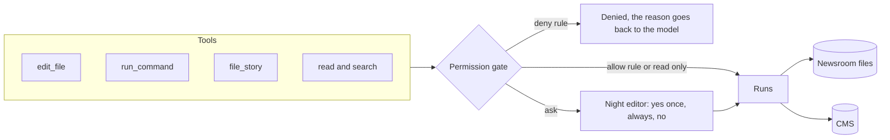

# Touch the world safely

## The problem

After part one, desk can read the newsroom. Now it must also change things. It must fix a figure in a draft,
add up numbers in a CSV file, and file a story to the CMS. Each of these can go wrong, and then a person must
clean up. A style fix can wipe out a whole paragraph. A command can hang. A story can go to the website before
its embargo, the time before which it must not be published.

For example, the press release `sources/press-releases/clinic-opening.txt` starts like this:

```text
MILLBROOK HEALTH PARTNERSHIP
EMBARGOED UNTIL 2026-11-13T09:00:00Z. Not for publication before this time.
```

The website updates before that time. So the draft `new-clinic-opening.md` must be held, not filed. In the
demo run, desk reads the draft and the press release, then calls `hold_story new-clinic-opening`.

A safe edit is small. The draft `river-levels.md` says the river peaked "on 9 November". The file
`sources/river-levels.csv` shows the peak, 3.4 metres, at `2026-11-10T04:00:00Z`. So desk changes the old text
`on 9 November` to the new text `on 10 November`, and nothing else.

So every tool that changes something must pass a gate first. The gate is a check in your code. It decides one
of three things: allow the tool, ask the night editor, or deny the tool.

## Why it matters

Asking is not enough on its own. Anthropic reports that people who use Claude Code "accept 93% of" its
permission prompts anyway ([Anthropic, read today](https://www.anthropic.com/research/claude-code-auto-mode)).
A gate that asks about everything teaches people to say yes. A useful gate does three things:

- It allows safe work without asking.
- It denies what must never happen.
- It asks only about the rest.



## Steps

| Step                 | Minutes | You build                                                                                                              | The check reads                                                                                                       |
| -------------------- | ------- | ---------------------------------------------------------------------------------------------------------------------- | --------------------------------------------------------------------------------------------------------------------- |
| `shape-the-tools`    | 15      | `list_files`, `search_files` and `file_story` with schemas the model uses well and errors that say what to try next    | Each schema, the error text for planted bad calls, the CMS filing log (two identical filings land once)               |
| `edit-drafts-safely` | 25      | `edit_file(path, old_text, new_text)` that refuses 0 or 2+ matches and a file not read first                           | The draft on disk after the run: one line changed, nothing else; the error results                                    |
| `run-commands`       | 15      | `run_command` with a timeout, a folder jail and output cut at 20,000 characters                                        | Exit and timing of a planted `sleep`, the length of the result, the answer to a sum over `sources/school-results.csv` |
| `ask-before-acting`  | 30      | Permission modes (`ask`, `accept-edits`, `plan`, `never-ask`) and rules (`allow`, `ask`, `deny`) in `desk.config.json` | The CMS after a "no" (unchanged), a deny that beats an allow, `plan` mode leaving files untouched                     |

This part takes 85 minutes.

## Walkthrough

TODO(part session): write the step folders, then replace this block with one `bun run verify <step-name>`
command per step, each with its Expect line.

```bash
bun run verify part touch-the-world-safely
```

Expect: TODO(part session). Until the steps exist it prints `0/0 steps pass`.

## Read

- [Writing effective tools for agents, with agents](https://www.anthropic.com/engineering/writing-tools-for-agents)
- [How we built Claude Code auto mode](https://www.anthropic.com/research/claude-code-auto-mode)
- [Beyond permission prompts](https://www.anthropic.com/research/claude-code-sandboxing) (optional)
