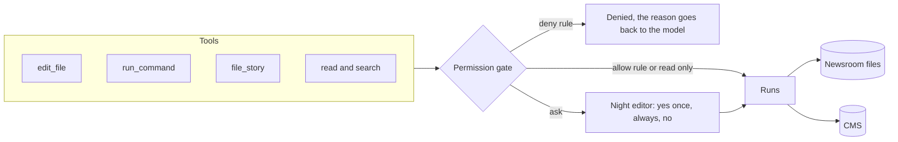

# Touch the world safely

## The problem

After part one, desk can read the newsroom. Tonight it must also change it: fix a figure in a draft, run a
quick sum over a CSV, and file a story to the CMS. Each of those can go wrong in a way a person has to clean up.
A style fix overwrites a whole paragraph. A command hangs. A story goes to the website before its embargo.
So every tool that changes something passes a gate first, and the gate decides: allow, ask the night editor,
or deny.

## Why it matters

Asking is not a control on its own. Anthropic reports that people using Claude Code "accept 93% of" its
permission prompts anyway ([Anthropic, read today](https://www.anthropic.com/research/claude-code-auto-mode)).
A gate that asks about everything trains people to say yes. The useful gate allows safe work without asking,
denies what must never happen, and asks only about the rest.



## Steps

| Step | Minutes | You build | The check reads |
|---|---|---|---|
| `shape-the-tools` | 15 | `list_files`, `search_files` and `file_story` with schemas the model uses well and errors that say what to try next | Each schema, the error text for planted bad calls, the CMS filing log (two identical filings land once) |
| `edit-drafts-safely` | 25 | `edit_file(path, old_text, new_text)` that refuses 0 or 2+ matches and a file not read first | The draft on disk after the run: one line changed, nothing else; the error results |
| `run-commands` | 15 | `run_command` with a timeout, a folder jail and output cut at 20,000 characters | Exit and timing of a planted `sleep`, the length of the result, the answer to a sum over `sources/school-results.csv` |
| `ask-before-acting` | 30 | Permission modes (`ask`, `accept-edits`, `plan`, `never-ask`) and rules (`allow`, `ask`, `deny`) in `desk.config.json` | The CMS after a "no" (unchanged), a deny that beats an allow, `plan` mode leaving files untouched |

Minutes in this part: 85.

## Walkthrough

TODO(part session): write the step folders, then replace this block with one `bun run verify <step-name>`
command per step, each with its Expect line.

```bash
bun run verify part touch-the-world-safely
```

Expect: TODO(part session). Until the steps exist it prints `0/0 steps pass`.

## Read

- [Writing effective tools for agents, with agents](https://www.anthropic.com/engineering/writing-tools-for-agents)
- [How we built Claude Code auto mode](https://www.anthropic.com/research/claude-code-auto-mode)
- [Beyond permission prompts](https://www.anthropic.com/research/claude-code-sandboxing) (optional)
