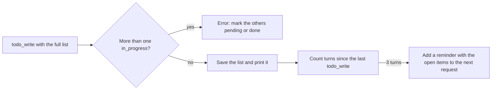
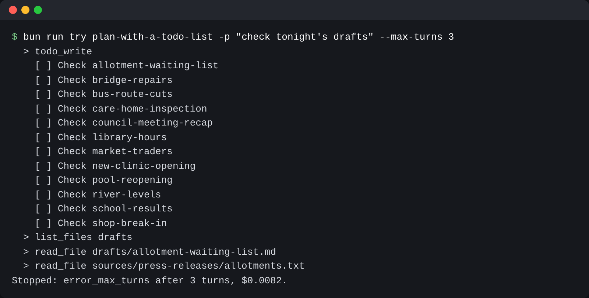

# Plan with a todo list

## The problem

Twelve drafts is a long night. After forty turns, the model can lose track of which drafts it has checked.
It may check `bridge-repairs` twice and never reach `shop-break-in`.

A todo list fixes this. The model writes its plan with a `todo_write` tool, and sends the full list each time
it changes. desk keeps the newest list and shows it in the terminal. For example:

```text
  > todo_write
    [x] Check allotment-waiting-list
    [>] Check bridge-repairs
    [ ] Check bus-route-cuts
```

`[x]` is done, `[>]` is in progress and `[ ]` is still to do. Only one item can be in progress, so the model
works on one draft at a time.

Sometimes the model stops updating the list. Then desk adds a short reminder to the next request. Anthropic's
long-running agents use the same idea: a plan in a file that a fresh session can pick up.



## Your challenge

This step starts from your part two desk. It adds a new file, `src/todos.ts`. The `todo_write` tool and its
schema are there, and `src/tools.ts` already offers it. `src/permissions.ts` counts it as read-only, because
it changes nothing in the newsroom.

1. In `writeTodos`, refuse a list with two items `in_progress`. Throw an error that says what to do.
2. Otherwise save the list, print it with one item per line and its mark, and return how many are done.
3. In `reminderAfterTurn`, count the turns since the last `todo_write`. After 3 turns with none, return a
   reminder that names `todo_write` and lists `openTodos()`. Then start counting again.

`src/main.ts` already calls `reminderAfterTurn` after each turn. It adds the reminder as a user message.

Run `bun run world reset` first. A `try` run changes the newsroom.

```bash
bun run try plan-with-a-todo-list solution -p "check tonight's drafts" --max-turns 3
```

Expect: the list of twelve drafts, each with `[ ]` in front.



## Done when

- A list with two items in progress comes back as an error.
- A good list is saved, and the terminal shows every item.
- After 3 turns with no `todo_write`, the next request has a reminder with the open items.
- No reminder comes before the list has gone 3 turns without a change.

```bash
bun run verify plan-with-a-todo-list
```

Expect: `Done. All 4 rules pass.`

## If you get stuck

| What you see                                                    | Fix                                                                  |
| --------------------------------------------------------------- | -------------------------------------------------------------------- |
| `FAIL  A good list is saved, and the terminal shows every item` | Print each item, such as `[>] Check bridge-repairs`.                 |
| `FAIL  After 3 turns with no todo_write, ...`                   | Keep the counter outside the function, so it lasts between turns.    |
| `FAIL  No reminder comes before ...`                            | Set the counter back to 0 after a `todo_write` and after a reminder. |

## Words you will use

- **Todo list**: the model's plan for the run, written with `todo_write`.
- **Stale**: not changed for a while. A stale list may mean the model lost its plan.
- **Reminder**: a short text desk adds to the next request. The model reads it like a note from the editor.
