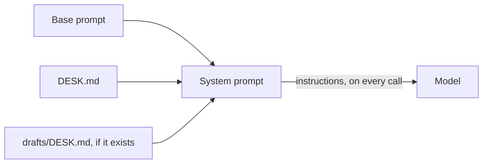

# Load the desk rules

## The problem

The night desk has standing rules in `DESK.md`. Rule 2 says: "Never name a person under 18 who appears in a police record."
desk does not know these rules yet. It only knows what the night editor types after `-p`.

The rules belong in the system prompt.

## Watch it done

The system prompt is the text that goes out with every request, before the conversation. It stays there when old
messages are dropped later in this part.

Some rules belong to one folder only. A file `drafts/DESK.md` can add rules for the drafts. The nearest file
comes last, so it has the last word. Claude Code reads `CLAUDE.md` files and Codex reads `AGENTS.md` files in
the same way.

For example, with both files, the system prompt that desk sends looks like this:

```text
You are desk, the night desk agent of the Millbrook Herald, ...

<desk-rules file="DESK.md">
# Night desk rules
...
2. Never name a person under 18 who appears in a police record. ...
</desk-rules>

<desk-rules file="drafts/DESK.md">
Keep headlines under 70 characters.
</desk-rules>
```



## Your turn

In `src/context.ts`, finish `systemPrompt()`:

1. Start with `BASE_PROMPT`.
2. Add `DESK.md`, then `drafts/DESK.md`, read from the newsroom folder. Skip a file that does not exist.
3. Wrap each file in `<desk-rules file="...">` and `</desk-rules>`, so the model knows where a rule came
   from.

`src/main.ts` already calls `systemPrompt()` once at the start of the run. It passes the result to
`streamText` as `instructions` on every call. So an edit to `DESK.md` shows up on the next run.

## Do it on your work

```bash
bun run verify load-the-desk-rules
```

Expect: `Done. All 4 rules pass.`

## Done when

- Every request's system prompt holds `DESK.md`, read fresh on this run.
- `drafts/DESK.md` comes after `DESK.md`, so the nearest file has the last word.
- With no `drafts/DESK.md`, desk still runs and loads `DESK.md`.
- The rules go in the system prompt, not in a user message.

## Solution

The sample answer is in `solution/`.

## If you get stuck

| What you see                                                      | Fix                                                                |
| ----------------------------------------------------------------- | ------------------------------------------------------------------ |
| `FAIL  Every request's system prompt holds DESK.md, ...`          | Read the file inside `systemPrompt()`, not at the top of the file. |
| `FAIL  drafts/DESK.md comes after DESK.md, ...`                   | Loop over `["DESK.md", "drafts/DESK.md"]` in that order.           |
| `FAIL  With no drafts/DESK.md, desk still runs and loads DESK.md` | Check `existsSync` before you read a file.                         |
| `FAIL  The rules go in the system prompt, not in a user message`  | Pass them as `instructions`, never as part of the task.            |

## Words you will use

- **System prompt**: text sent before the conversation on every call. The model treats it as its standing
  orders.
- **Rules file**: a Markdown file of standing rules, such as `DESK.md`, `CLAUDE.md` or `AGENTS.md`.
- **Nearest file**: the rules file closest to the work. It comes last, so it has the last word.
