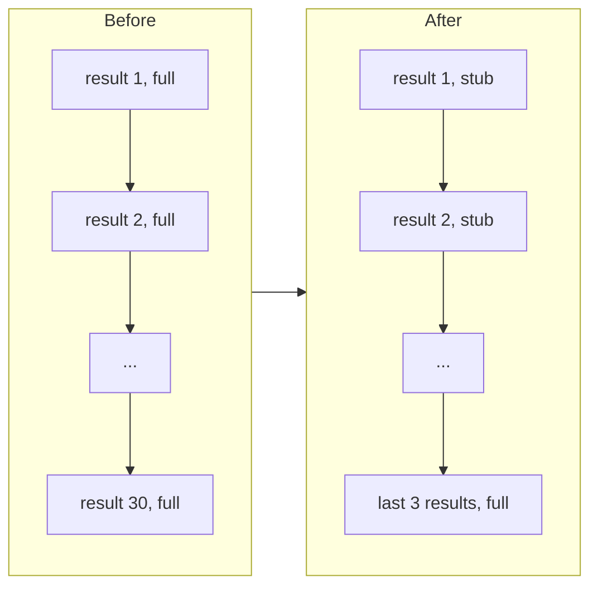

# Trim old results

This is a deeper step. You can skip it: the next step's starter already has the answer.

## The problem

Every tool result stays in the conversation, and the whole conversation goes out on every call. After desk
reads thirty drafts, it sends all thirty drafts again on call thirty-one. The model needs only the last few.
The rest costs money and pushes the rules out of view.

For example, here is an old result before and after trimming:

```text
before: ---\nslug: bridge-repairs\nheadline: Bridge repairs to cost ... (620 characters)
after:  [trimmed: 620 characters, in .desk/results/toolu_abc123.txt]
```

The stub keeps the call paired with its result, and says where the full text is.



## Your challenge

In `src/context.ts`, write `trimOldResults(messages)`. `src/main.ts` already calls it before every call.

1. Find the tool messages: the messages with `role: "tool"`.
2. Leave the last `KEEP_FULL` (3) alone. They are the ones the model is working on.
3. In each older one, look at every `tool-result` part. Skip a part that is already a stub.
4. Save its full text to `.desk/results/<toolCallId>.txt`.
5. Change its `output` to a text stub that gives the length and the saved path.

6. Trim in batches. Model services keep a cache of the start of your conversation, so a repeat call costs far
   less. The cache only works while that start stays the same. A trim changes old messages. If you trim on every
   call, the cache never hits. So wait until `BATCH` (8) old results are still whole, then trim them all at once.

Change the parts in place. Never delete a part or a message: a tool call with no result is an error.

```bash
bun run verify trim-old-results
```

Expect: `Done. All 5 rules pass.`

## Done when

- By the last request, the tool results take at least 50% less room than the files read.
- Every tool call still has exactly one result.
- The last 3 tool results are still whole.
- Each stub names a saved file that holds the full text.
- Trimming comes in batches, so at least 20 of 29 calls only add to the end of the last one.

## If you get stuck

| What you see                                                  | Fix                                                           |
| ------------------------------------------------------------- | ------------------------------------------------------------- |
| `FAIL  By the last request, the tool results take ...`        | Check that `main.ts` calls `trimOldResults` before each call. |
| `FAIL  Every tool call still has exactly one result`          | Change `part.output`. Do not remove parts.                    |
| `FAIL  The last 3 tool results are still whole`               | Use `toolMessages.slice(0, -KEEP_FULL)` for the old ones.     |
| `FAIL  Each stub names a saved file that holds the full text` | Write the file before you change the part.                    |

## Words you will use

- **Stub**: a short stand-in for a long text. It says what was there and where to find it.
- **Tool result**: the text desk sends back for one tool call, paired with the call's id.
- **Token consumption**: how many tokens a run sends and receives. It is what you pay for.
