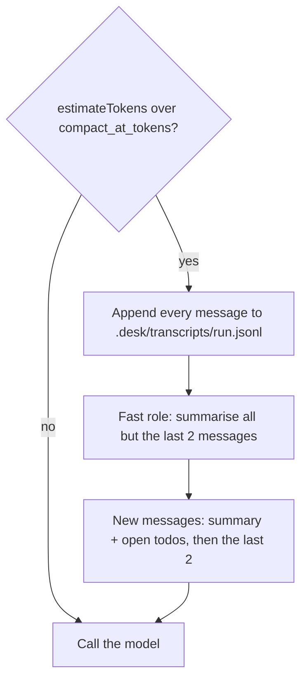
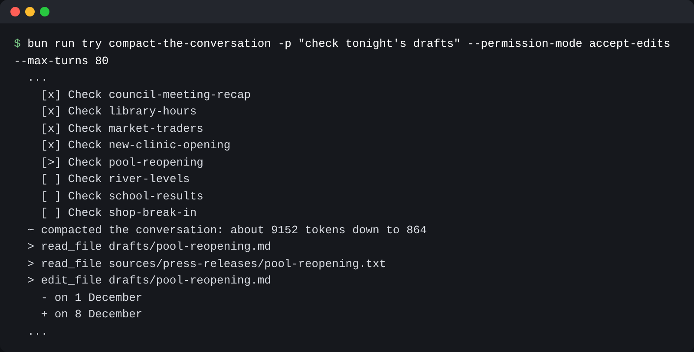

# Compact the conversation

## The problem

Trimming is not enough on a long night. The model's own words and the tool calls still pile up. At some size
the request is too big for the context window, or too slow and costly to send.

Compaction fixes this. When the conversation passes a size limit, desk asks the cheap fast role to write a
summary. Then it swaps the old messages for that summary and carries on.

But a summary can forget things. For example, the summary may say "read 9 drafts" and leave out that
`shop-break-in` is still to do. So desk does not trust the summary with what matters:

- The open todo items go in after the summary, from `openTodos()`.
- The desk rules stay in the system prompt, which compaction never touches.
- The full conversation is saved to a file first, so nothing is lost for good.

The finished desk prints a line like this when it compacts:

```text
  ~ compacted the conversation: about 9211 tokens down to 418
```



## Your challenge

In `src/context.ts`, write `compact(messages, runId)`. The rest is in place: `compactAtTokens()` reads the
limit from `desk.config.json`, and `keepContextSmall()` in `src/main.ts` calls `compact` when the limit is
passed.

1. Append every message to `.desk/transcripts/<runId>.jsonl`, one JSON line each.
2. Call `generateText` with `model("fast")`, `SUMMARY_RULES`, and `render()` of all but the last two messages.
3. Build one user message: the summary, then `openTodos()`.
4. Return that message and the last two messages, with the cost of the summary call.

Keep the line format of `render()` and the first words of `SUMMARY_RULES`. The practice model reads them to
write its summary.

Run `bun run world reset` first. A `try` run changes the newsroom.

```bash
cp finished/desk.config.json world/newsroom/desk.config.json
bun run try compact-the-conversation solution -p "check tonight's drafts" --permission-mode accept-edits --max-turns 80 < /dev/null
```

Expect: a line that starts with `  ~ compacted the conversation: about`.

With `< /dev/null`, every prompt gets no. So the CMS files nothing, even when the last line says `Filed 9`.



## Done when

- Past the threshold, desk asks the fast role for a summary.
- The first request after the summary is under the threshold and starts with the summary.
- The open todo items are still in the request after the summary.
- The desk rules, with "never name a person under 18", are still sent after the summary.
- The saved transcript holds every tool call from before the summary.

```bash
bun run verify compact-the-conversation
```

Expect: `Done. All 5 rules pass.`

## If you get stuck

| What you see                                             | Fix                                                |
| -------------------------------------------------------- | -------------------------------------------------- |
| `FAIL  Past the threshold, desk asks the fast role ...`  | Use `model("fast")`. A summary is cheap work.      |
| `FAIL  The open todo items are still in the request ...` | Add `openTodos()` to the summary message yourself. |
| `FAIL  The saved transcript holds every tool call ...`   | Save before you summarise, with `appendFileSync`.  |

## Words you will use

- **Compaction**: swapping old messages for a short summary, so the conversation fits again.
- **Threshold**: the size that starts compaction, `compact_at_tokens` in `desk.config.json`.
- **Transcript**: the full record of a run, saved to a file before compaction.
