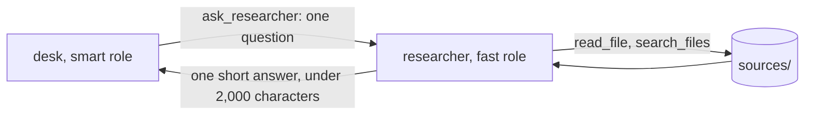

# Delegate to a subagent

## The problem

The draft `council-meeting-recap.md` says the car park motion was "voted 9 to 4". To check it, desk must find
the vote in `sources/council-meeting-transcript.txt`. That file is about 400,000 characters long. Reading it
would fill desk's context window with one meeting.

So desk hands the question to a helper. A helper agent, also called a subagent, runs its own small loop with a
fresh context. It searches the transcript and sends back one short answer. For example:

```text
  > ask_researcher
desk sees: The motion was carried 11 votes to 4 (sources/council-meeting-transcript.txt, line 1791).
```

desk never sees the pages the helper read. That is the point. Anthropic's research system with helpers beat a
single agent by 90.2% on their own test. But it used "about 15× more tokens than chats". So the helper uses the
cheap fast role, and its cost counts toward desk's budget.



## Your challenge

In `src/researcher.ts`, write `askResearcher(input)`. `src/tools.ts` already offers `ask_researcher` and runs
it. `src/main.ts` already adds `researcherCost` to the total.

1. Start a new `messages` list with only the question. Nothing from desk's conversation goes in.
2. Loop at most `MAX_TURNS` (6) times. Call `generateText` with `model("fast")`, `RESEARCHER_RULES` and
   only the read-only tools: `read_file`, `list_files` and `search_files`.
3. Add each call's cost to `researcherCost` with `costUsd("fast", reply.usage)`.
4. Run the tool calls with `runTool` and send the results back, like desk's own loop.
5. When the model answers with no tool call, return its text, cut to 2,000 characters.
6. After 6 turns, return a short line that says the researcher found no answer.

The helper never gets `ask_researcher`, so it cannot start a helper of its own. And it never gets
`edit_file` or `file_story`, so it cannot change the newsroom.

```bash
bun run verify delegate-to-a-subagent
```

Expect: `Done. All 5 rules pass.`

## Done when

- The researcher starts with a fresh context on the fast role: only the question.
- The researcher is offered the read-only tools only, and never `ask_researcher`.
- desk gets the short answer only: under 2,000 characters, none of the files read.
- The researcher stops at its cap of 6 turns, and desk carries on.
- The cost desk prints includes the researcher's calls.

## If you get stuck

| What you see                                                    | Fix                                                   |
| --------------------------------------------------------------- | ----------------------------------------------------- |
| `FAIL  The researcher is offered the read-only tools only, ...` | Build the tool set inside the function, from `tools`. |
| `FAIL  desk gets the short answer only: ...`                    | Return `reply.text`, never the messages.              |
| `FAIL  The cost desk prints includes the researcher's calls`    | Add to `researcherCost` after every `generateText`.   |

## Words you will use

- **Subagent**: a helper agent with its own loop and its own fresh context.
- **Fresh context**: a conversation that starts empty, with only the question.
- **Fast role**: the cheaper model in `config/models.ts`, for simple work like searching.
