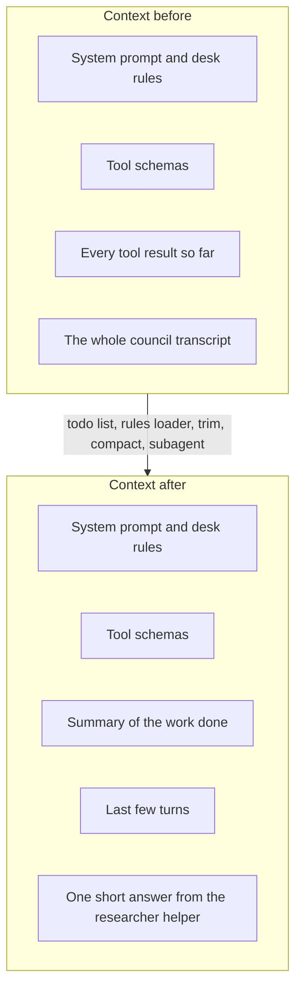

# Keep the context clean

## The problem

The council meeting transcript in `sources/` is about 400,000 characters. Read it whole and it pushes the desk
rules out of the model's view, and the agent forgets the one that matters most: never name a person under 18.
Twelve drafts, their sources and every tool result pile up turn after turn. The model gets slower, dearer and
less careful. desk has to plan, keep its standing rules in view, and throw away what it no longer needs.

## Why it matters

Anthropic measured this on a 100-turn web search task: clearing old tool results let agents finish work that
would otherwise fail, "while reducing token consumption by 84%"
([Anthropic, read today](https://claude.com/blog/context-management)). Handing a question to a helper with its
own clean context also pays: Anthropic's research system with helper agents beat a single agent by 90.2% on
their internal research eval ([Anthropic, read today](https://www.anthropic.com/engineering/built-multi-agent-research-system)),
at the cost of many more tokens. This part measures both trade-offs on the newsroom.



## Steps

| Step | Minutes | You build | The check reads |
|---|---|---|---|
| `plan-with-a-todo-list` | 15 | A `todo_write` tool (the full list on every call, one item in progress) and a reminder when the list goes stale | Error results for two items in progress, the reminder in the request after 3 turns with no update |
| `load-the-desk-rules` | 10 | `DESK.md` and `drafts/DESK.md` loaded into the system prompt, nearest last | The system prompt of the recorded request, before and after an edit to `DESK.md` |
| `trim-old-results` (deeper) | 15 | Old tool results replaced by a stub that says where the full text is | Request size on a 30-turn script (at least 50% smaller), every call still paired with a result |
| `compact-the-conversation` | 25 | Compaction at a token threshold on the fast role, the full transcript saved first | The request after the threshold: a summary, under the target size, open todo items and the desk rules still present |
| `delegate-to-a-subagent` | 25 | `ask_researcher`: a child loop on the fast role with a fresh context, read-only tools and a turn cap | The parent's next request grows by the answer only (under 2,000 characters), the child cannot file or edit, its cost is in the total |

Minutes in this part: 90, of which 15 are the deeper step.

## Walkthrough

TODO(part session): write the step folders, then replace this block with one `bun run verify <step-name>`
command per step, each with its Expect line.

```bash
bun run verify part keep-the-context-clean
```

Expect: TODO(part session). Until the steps exist this prints that the part has no steps.

## Read

- [Effective context engineering for AI agents](https://www.anthropic.com/engineering/effective-context-engineering-for-ai-agents)
- [Compaction overview](https://platform.claude.com/docs/en/build-with-claude/compaction)
- [How we built our multi-agent research system](https://www.anthropic.com/engineering/built-multi-agent-research-system)
