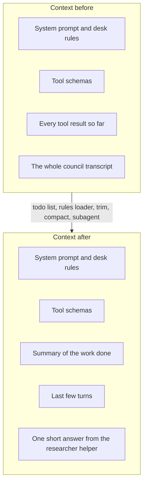

# Keep the context clean

## The problem

The context is everything the model can see at one time. It holds the rules, the tool results and the whole
conversation so far. The council meeting transcript in `sources/` is about 400,000 characters long. If desk
reads all of it, the transcript pushes the desk rules out of the model's view. Then the agent can forget the
rule that matters most: never name a person under 18.

Twelve drafts, their sources and every tool result add up, turn after turn. The model gets slower, costs more
and makes more mistakes. So desk must plan its work. It must keep its standing rules in view. And it must throw
away what it no longer needs.

For example, the finished desk does not read the transcript itself. It hands one question to a helper agent:

```text
  > read_file drafts/council-meeting-recap.md
  > ask_researcher In the council meeting transcript, what was the final vote on the c...
```

The helper searches the transcript and sends back one short answer: "The motion was carried 11 votes to 4". Only
that answer goes into the context of desk. Later in the same run, desk prints this line:

```text
  ~ compacted the conversation: about 9176 tokens down to 1553
```

Compaction means desk swaps the old turns for a short summary. A token is a small piece of a word. Here the
context shrinks to about one sixth of its size.

## Why it matters

Anthropic measured this on a web search task of 100 turns. Clearing old tool results let agents finish work
that would fail without it, "while reducing token consumption by 84%"
([Anthropic, read today](https://claude.com/blog/context-management)).

A helper agent with its own clean context also helps. Anthropic's research system with helper agents beat a
single agent by 90.2% on their own research test
([Anthropic, read today](https://www.anthropic.com/engineering/built-multi-agent-research-system)). But it
used many more tokens. In this part, you measure both of these trade-offs on the newsroom.



## Steps

| Step                        | Minutes | You build                                                                                                       | The check reads                                                                                                                      |
| --------------------------- | ------- | --------------------------------------------------------------------------------------------------------------- | ------------------------------------------------------------------------------------------------------------------------------------ |
| `plan-with-a-todo-list`     | 15      | A `todo_write` tool (the full list on every call, one item in progress) and a reminder when the list goes stale | Error results for two items in progress, the reminder in the request after 3 turns with no update                                    |
| `load-the-desk-rules`       | 10      | `DESK.md` and `drafts/DESK.md` loaded into the system prompt, nearest last                                      | The system prompt of the recorded request, before and after an edit to `DESK.md`                                                     |
| `trim-old-results` (deeper) | 15      | Old tool results replaced by a stub that says where the full text is                                            | Request size on a 30-turn script (at least 50% smaller), every call still paired with a result                                       |
| `compact-the-conversation`  | 25      | Compaction at a token threshold on the fast role, the full transcript saved first                               | The request after the threshold: a summary, under the target size, open todo items and the desk rules still present                  |
| `delegate-to-a-subagent`    | 25      | `ask_researcher`: a child loop on the fast role with a fresh context, read-only tools and a turn cap            | The parent's next request grows by the answer only (under 2,000 characters), the child cannot file or edit, its cost is in the total |

This part takes 90 minutes. The deeper step is 15 of them.

## Walkthrough

TODO(part session): write the step folders, then replace this block with one `bun run verify <step-name>`
command per step, each with its Expect line.

```bash
bun run verify part keep-the-context-clean
```

Expect: TODO(part session). Until the steps exist it prints `0/0 steps pass`.

## Read

- [Effective context engineering for AI agents](https://www.anthropic.com/engineering/effective-context-engineering-for-ai-agents)
- [Compaction overview](https://platform.claude.com/docs/en/build-with-claude/compaction)
- [How we built our multi-agent research system](https://www.anthropic.com/engineering/built-multi-agent-research-system)
