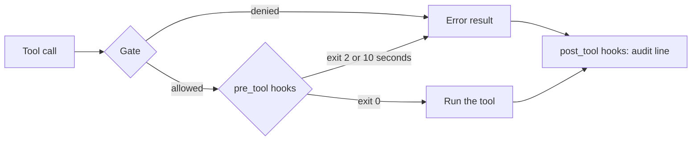

# Add hooks

## The problem

The night editor has rules that are not up to the model. A story must never go out before its embargo. And
every tool call must leave a line in an audit log, so anyone can replay the night later.

A hook is a small program that desk runs around every tool call. The night editor writes the hooks and lists
them in `desk.config.json`. desk runs them, so the model cannot talk its way past them.

- A `pre_tool` hook runs before the tool. If it exits with code 2, the call is blocked. What it printed on
  stderr is the reason, and the model reads it.
- A `post_tool` hook runs after the call, blocked calls too. It records. It cannot change the result.

Two hooks are ready in this step's `hooks/` folder. For example, here is what the embargo hook does with a
filing of `new-clinic-opening`:

```text
stdin:  {"tool_name":"file_story","tool_input":{"slug":"new-clinic-opening","note":"..."}}
stderr: Embargoed until 2026-11-13T09:00:00Z. It cannot go out tonight. Use hold_story instead.
exit code: 2
```

A hook can also hang. A hook that never ends must not stop the whole night, so desk stops it after 10
seconds and denies the call, to be safe.



## Your challenge

This step starts from your part three desk. It now has more files, and some of them are empty until a
later step. `src/main.ts` already calls the two functions you write.

In `src/hooks.ts`:

1. Read `hooks` from `desk.config.json`. A hook has a `match` (a tool name, or `*` for every tool) and a
   `command`.
2. Run a hook with `Bun.spawnSync(["bash", "-c", command])` in the newsroom folder. Send the call as JSON on
   stdin, and set a timeout of 10 seconds.
3. `blockedByHook`: for each matching `pre_tool` hook, return its stderr when it exits with code 2. Return a
   reason when it timed out. Return `null` when every hook lets the call through.
4. `recordAfterTool`: run each matching `post_tool` hook with the call and its result.

The config the check writes looks like this:

```json
{ "hooks": { "pre_tool": [{ "match": "file_story", "command": "bun hooks/embargo-check.ts" }] } }
```

```bash
bun run verify add-hooks
```

Expect: `Done. All 4 rules pass.` One rule waits for a hung hook, so the check takes about 40 seconds.

## Done when

- The embargo hook stops `new-clinic-opening` before the CMS, and the model hears why.
- A story with no embargo still files.
- The audit hook writes one line per tool call, blocked calls too.
- A hook that hangs is stopped within 15 seconds and the call is denied.

## If you get stuck

| What you see                                               | Fix                                                            |
| ---------------------------------------------------------- | -------------------------------------------------------------- |
| `FAIL  The embargo hook stops new-clinic-opening ...`      | Block only on exit code 2. Code 1 means the hook itself broke. |
| `FAIL  The audit hook writes one line per tool call, ...`  | Call `post_tool` hooks for errors too.                         |
| `FAIL  A hook that hangs is stopped within 15 seconds ...` | Check `exitedDueToTimeout` after `Bun.spawnSync`.              |

## Words you will use

- **Hook**: a program desk runs before or after a tool call.
- **Audit log**: a file with one line per action, so someone can check the night later.
- **Embargo**: the time before which a story must not be published.
