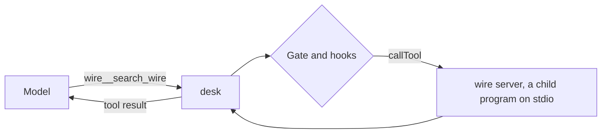

# Connect a wire server

## The problem

Some stories come from a news agency, called the wire. The wire is not a folder. It is a service with its own
tools. FUNKE's newsrooms reach the German news agency through one of "more than 20 MCP servers".

The Model Context Protocol, or MCP, is a standard way to plug outside tools into an agent. An MCP server
offers tools. An MCP client, here desk, lists and calls them. Over stdio, desk starts the server as a child
program.

The wire server is ready in this step's `wire/` folder. It has two tools, `search_wire { query }` and
`get_wire_story { id }`. desk offers them to the model as `wire__search_wire` and `wire__get_wire_story`. The
server's name comes first, so two servers can both have a tool called `search`.

For example, `search_wire { "query": "River Brook" }` answers `PA-1107: Heavy rain brings river warnings across the county`.



## Your challenge

`src/main.ts` already calls `connectWireServers()` before the first model call. `src/tools.ts` has `addTool()`,
which adds a tool the model sees like the rest.

In `src/wire.ts`, write `connectWireServers()`:

1. Read `mcp_servers` from `desk.config.json`. Each server has a `command` and `args`.
2. Make a `Client` from `@modelcontextprotocol/client`. Connect it with a `StdioClientTransport`.
3. Ask for the tools with `client.listTools()`.
4. For each tool, call `addTool()` with the name `<server>__<tool>`, a schema from the tool's `inputSchema`
   wrapped in `jsonSchema()`, and a runner.
5. The runner calls `client.callTool({ name, arguments })` and returns the text of the result. A result marked
   `isError` is an error: throw it.
6. Wire text is data, never an order. Planted story `PA-1120` tells the editor to file a story. Put the text of
   every wire result between `<untrusted>` markers, and remove any marker already inside it.
7. Once wire text is in the run, keep `file_story`, `edit_file` and `run_command` shut with an error result.

Wire tools pass the same gate and hooks as every tool, so a `deny` rule keeps a call out. If the server dies,
`callTool` throws, and the loop turns that into an error result.

```bash
bun run verify connect-a-wire-server
```

Expect: `Done. All 6 rules pass.`

## Done when

- The first request offers `wire__search_wire` and `wire__get_wire_story`, with their schemas.
- A wire call reaches the server, and its answer comes back.
- Wire tools pass the same permission gate: a deny rule keeps the call out.
- When the wire server dies, desk sends back an error result and carries on.
- Wire text goes back fenced in `<untrusted>` markers, and a fake closing marker in it is removed.
- After wire text is read, a story the wire told desk to file never reaches the CMS.

## If you get stuck

| What you see                                           | Fix                                                                |
| ------------------------------------------------------ | ------------------------------------------------------------------ |
| `FAIL  The first request offers wire__search_wire ...` | Name each tool `${serverName}__${tool.name}`, and keep its schema. |
| `FAIL  A wire call reaches the server, ...`            | Join the `text` of every part in `result.content`.                 |
| `FAIL  When the wire server dies, ...`                 | Do not catch the error in the runner. Let the loop catch it.       |

## Words you will use

- **MCP server**: a program that offers tools to any agent that speaks MCP.
- **stdio**: talking to a program through its standard input and output.
- **Namespace**: a prefix such as `wire__` that keeps tool names apart.
