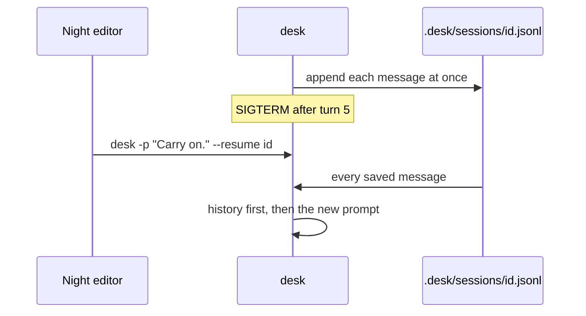

# Resume a session

## The problem

The night run takes a while. The laptop can sleep or someone can press Ctrl+C. Then everything desk knew is
gone, and a new run may file `bridge-repairs` a second time.

So desk saves every message to a session file at once.

## Watch it done

One run is one file, `.desk/sessions/<id>.jsonl`, with one JSON message per line.

For example, after two turns a session file starts like this:

```text
{"role":"user","content":"Check tonight's drafts."}
{"role":"assistant","content":[{"type":"tool-call","toolName":"read_file", ...}]}
{"role":"tool","content":[{"type":"tool-result","toolName":"read_file", ...}]}
```

To carry on, run desk with `--resume <id>`, or `--continue` for the newest session. desk sends the saved history
first, so the model sees the filing it already made.



## Your turn

`src/main.ts` already calls `openSession()` at the start, starts from `session.history`, and calls
`session.save()` for every new message. In `src/session.ts`, write `openSession()`:

1. Keep session files in `.desk/sessions/` in the newsroom folder.
2. With `--resume <id>`, use that id. With `--continue`, use the file that changed last.
3. A resumed session's history is its file, one `JSON.parse` per line.
4. `save()` appends each message with `appendFileSync`, at once.
5. A new session gets a short id, such as `crypto.randomUUID().slice(0, 8)`.

Two more moves, because a run can stop midway:

6. Listen for `SIGINT`, the signal Ctrl-C sends. Set a flag, finish the step, give each pending tool call an
   error result, print `Interrupted. Resume with: --resume <id>`, and exit 130.
7. On load, drop a last assistant message whose tool call has no result. That is the repair after a crash. Then
   add `--rewind <n>`: drop the last `n` turns and rewrite the file. It undoes the talk, not the work.

desk prints the id on its first line, such as `desk session` and a short id. Keep it to resume.

## Do it on your work

```bash
bun run verify resume-a-session
```

Expect: `Done. All 8 rules pass.`

## Done when

- Each message is saved at once: after the stop, the session file holds the run so far.
- `--resume <id>` sends the saved history in its first request.
- After the resumed run, each story was filed once, never twice.
- `--continue` picks up the newest session.
- Ctrl-C stops desk with exit 130 and prints how to resume the session.
- After Ctrl-C every tool call in the saved session has a result.
- A session cut off between a tool call and its result is repaired when it is resumed.
- `--rewind 1` drops the last turn from what the model sees and from the saved file.

## Solution

The sample answer is in `solution/`.

## If you get stuck

| What you see                                                       | Fix                                                           |
| ------------------------------------------------------------------ | ------------------------------------------------------------- |
| `FAIL  Each message is saved at once: ...`                         | Write in `save()`, not when desk ends. SIGTERM skips the end. |
| `FAIL  --resume <id> sends the saved history in its first request` | Return the parsed lines as `history`.                         |
| `FAIL  --continue picks up the newest session`                     | Sort by `statSync(file).mtimeMs`, newest first.               |

## Words you will use

- **Session**: one run of desk, saved so it can carry on later.
- **JSONL**: a text file with one JSON value on each line.
- **SIGTERM**: the signal a system sends to ask a program to stop.
