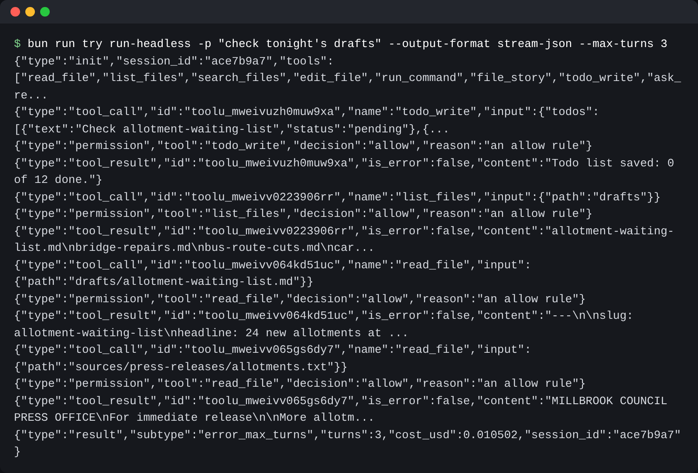

# Run headless

## The problem

The night editor wants desk to run from a script before the 06:00 update, with nobody watching. A run like
that is called headless. Katadata runs its news analysis this way, over "10,000 articles daily".

A script cannot read lines meant for a person. It needs JSON, and an exit code that says how the run ended.
And it can never answer a permission prompt.

So desk prints events. Each event is one thing that happened: the run started, the model wrote text, a tool
was called, a result came back, the run ended. `--output-format` picks how they print:

- `text`: lines for a person, as before.
- `stream-json`: one JSON object per line, as each event happens.
- `json`: only the last event, the result, as one line.

For example, a short `stream-json` run prints:

```text
{"type":"init","session_id":"3f9a1c2e","tools":["read_file", ...]}
{"type":"tool_call","id":"toolu_01","name":"read_file","input":{"path":"drafts/bridge-repairs.md"}}
{"type":"tool_result","id":"toolu_01","is_error":false,"content":"---\nslug: bridge-repairs ..."}
{"type":"result","subtype":"success","turns":2,"cost_usd":0.0031,"session_id":"3f9a1c2e"}
```

Every event fits a contract, `checks/helpers/contract.schema.json`. Any harness that prints these lines can be
checked and scored the same way.

| Exit code | Subtype                               | Means                               |
| --------- | ------------------------------------- | ----------------------------------- |
| 0         | `success`                             | The model finished                  |
| 1         | `error`                               | Something broke, such as the API    |
| 3         | `error_max_turns`, `error_max_budget` | A cap stopped the run               |
| 4         | `error_permission`                    | A call was denied in never-ask mode |



## Your challenge

`src/main.ts` already sends every event to `emit()`. In `src/output.ts`:

1. Read `--output-format`. For `stream-json`, print every event as one JSON line. For `json`, print only the
   result event. For `text`, print as now.
2. In `exitCodeFor`, return 1 for `error` and 4 for `error_permission`.

In `src/permissions.ts`, ask on stderr, not stdout, so the JSON stays clean. Read the answer with
`console[Symbol.asyncIterator]()`, one line at a time. When stdin has no more lines, the answer is no.
`decide()` now returns a promise; `main.ts` already awaits it. In `src/todos.ts`, print the list with
`console.error`.

```bash
bun run verify run-headless
```

Expect: `Done. All 5 rules pass.`

## Done when

- Every stream-json line is one JSON event that fits the contract.
- stream-json opens with init, has a call and a result per tool call, ends with result.
- Exit codes: 0 on success, 3 at a cap, 4 for a denial in never-ask mode, 1 on an error.
- `--output-format json` prints one line: the result.
- With nobody at the terminal, a call that would ask is denied, and desk never waits.

## If you get stuck

| What you see                                         | Fix                                                        |
| ---------------------------------------------------- | ---------------------------------------------------------- |
| `FAIL  Every stream-json line is one JSON event ...` | Look for `console.log` outside `output.ts`. Use stderr.    |
| `FAIL  Exit codes: 0 on success, ...`                | A denial in never-ask mode is a failure, even if it ended. |

## Words you will use

- **Headless**: a run with no person at the terminal.
- **stdout and stderr**: the two places a program prints to. A script reads stdout, so prompts go to stderr.
- **stdin**: where a program reads what you type. In a headless run, it is often empty.
- **Event**: one thing that happened in a run, printed as one JSON object.
- **Contract**: the fixed names and fields a program can count on.
