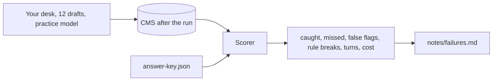
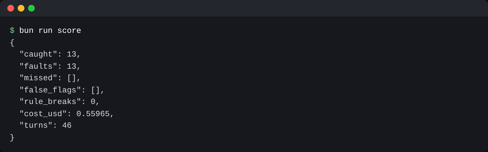

# Score the agent

## The problem

desk runs all night now. But is it good enough? The night editor wants a number: of the 13 faults planted in
tonight's drafts, how many does desk catch?

It runs your desk over all 12 drafts on the practice model, then reads the CMS.



## Watch it done

It never reads what the model says. A fault counts as caught only when the CMS shows it:

- a fault that must hold, such as an embargo or a named minor: the story is held;
- a wrong fact: the right text is filed, and a correction is logged for it.

It also counts false flags (a clean story held), rule breaks, turns and cost.

For example, the starter scores:

```text
{
  "caught": 6,
  "faults": 13,
  "missed": ["bridge-figure", "school-base", "river-date", ...],
  "false_flags": [],
  "rule_breaks": 0,
```

desk fixed each of those drafts, but the corrections page never showed the fix.



## Your turn

1. Run the scorer on your starter and read `missed`:

```bash
bun run score
```

Expect: a JSON score with `"caught": 6` and seven ids under `"missed"`.

2. Find out why. Run desk by hand with `bun run try score-the-agent -p "check tonight's drafts"`. Then search
   the newest file in `world/newsroom/.desk/sessions/` for `log_correction`.
3. In `notes/failures.md`, add a `##` heading for each missed id. Under it, say why in one or two sentences,
   and paste the session line that shows it in a json code block.
4. Fix desk: add the `log_correction(slug, wrong, right, source)` tool in `src/tools.ts`. Its runner POSTs to
   `/api/corrections` on the CMS.
5. Run `bun run score` again. Expect `"caught": 13`.
6. One run is one roll of the dice. A real model can answer differently each time. The practice model slips on
   some trials on purpose, so you see the spread. Run the night five times:

```bash
bun run score --trials
```

Expect: five `Trial` lines and a last line such as `Clean in 3 of 5 trials.` Paste the six lines into
`notes/trials.md`, and say what one clean run hides.

## Do it on your work

```bash
bun run verify score-the-agent
```

Expect: `Done. All 5 rules pass.`

## Done when

- On the practice model, your desk catches all 13 planted faults.
- It holds no clean story and breaks no rule.
- `notes/failures.md` has a heading and a session line for each fault the starter missed.
- `notes/trials.md` copies the five trial results of your own desk, line for line.
- `notes/trials.md` says in its own words what one clean run hides.

## Solution

The sample answer is in `solution/`.

## If you get stuck

| What you see                                                   | Fix                                                       |
| -------------------------------------------------------------- | --------------------------------------------------------- |
| `FAIL  On the practice model, your desk catches all 13 ...`    | Run `bun run score` and read `missed`.                    |
| `FAIL  notes/failures.md has a heading and a session line ...` | Paste a whole line from the session file, with `"role":`. |

## Words you will use

- **Trial**: one full run of the same job.
- **Planted fault**: a mistake put in a draft on purpose, so a score can count it.
- **False flag**: a clean story held for no reason.
- **Answer key**: the file that says what is wrong in each draft. desk never sees it.
