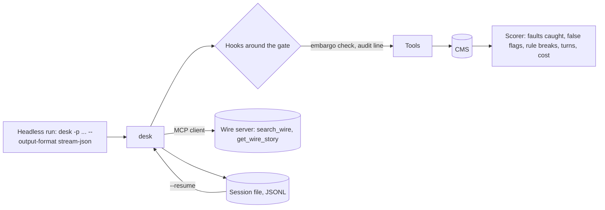

# Extend and ship

## The problem

The night editor wants desk to run with nobody watching, before the website updates. A run like that is called
headless. It changes the job in five ways:

- No one can answer a permission prompt. So the run must deny the tool, not wait forever. It must also say so
  with an exit code that a script can read. An exit code is the number a program returns when it ends.
- After a crash in the middle, desk must pick up again without filing a story twice.
- Every tool call must leave an audit line, a record of the call in a log file.
- Wire stories come from the server of a news agency, not from a folder.
- Before the editor trusts desk, it needs a score on the planted faults. That score sits next to the score of a
  real harness on the same drafts.

For example, the finished desk can print one line of JSON at the end of a run. A script can read it:

```text
{"type":"result","subtype":"success","turns":46,"cost_usd":0.425663,"session_id":"fb702246","text":"Tonight's drafts are done. Filed 9, held 3, logged 7 corrections. The held stories need the night editor.","events":204}
```

You get this line from `bun run demo --output-format json`. The `subtype` says how the run ended. The
`session_id` lets you resume the run later.

## Why it matters

Newsrooms already run agents this way. Katadata's news analysis system "scales to process over 10,000 articles
daily". Its analysis time fell "from 3 hours to 15 minutes"
([Google Cloud customer story, read today](https://cloud.google.com/customers/katadata)).

FUNKE Mediengruppe runs its tools through "a central registry on the Model Context Protocol with more than 20
MCP servers". The Model Context Protocol, or MCP, is a standard way to plug outside tools into an agent. One of
those servers is for Germany's national news agency
([Google Cloud customer story, read today](https://cloud.google.com/customers/funkemediengruppe)).

Both stories come from a company that sells to these newsrooms. The numbers are the claims of the newsrooms, as
that company published them.



## Steps

| Step                                | Minutes | You build                                                                                              | The check reads                                                                                                                   |
| ----------------------------------- | ------- | ------------------------------------------------------------------------------------------------------ | --------------------------------------------------------------------------------------------------------------------------------- |
| `add-hooks`                         | 20      | `pre_tool` and `post_tool` hooks run as shell commands from config; exit 2 blocks with a reason        | The CMS after an embargoed filing (refused by the hook), the audit JSONL (one line per call), a hung hook killed after 10 seconds |
| `connect-a-wire-server`             | 20      | An MCP client over stdio with `@modelcontextprotocol/client`; wire tools appear as `wire__search_wire` | The tool list in the recorded request, the wire server's own call log, an error result when the server dies                       |
| `resume-a-session`                  | 15      | An append-only JSONL session file, `--resume <id>` and `--continue`                                    | The first request after a resume (history equal to the saved one), the CMS after a stopped and resumed run (no story filed twice) |
| `run-headless`                      | 15      | `-p` with `--output-format text`, `json` and `stream-json`, and the exit codes                         | Every stdout line against `checks/lib/contract.schema.json`, exit codes 0, 1, 3 and 4                                             |
| `score-the-agent`                   | 25      | `bun run score` over the 12 drafts: faults caught, false flags, rule breaks, turns, cost               | The scorer's JSON against the answer key, `notes/failures.md` with a session line per missed fault                                |
| `rebuild-on-the-agent-sdk` (deeper) | 30      | `desk-sdk/`: the same tools under the Claude Agent SDK                                                 | The same contract run and score, and `notes/sdk-compare.md` with its four headings                                                |

This part takes 125 minutes. The deeper step is 30 of them.

## Walkthrough

TODO(part session): write the step folders, then replace this block with one `bun run verify <step-name>`
command per step, each with its Expect line.

```bash
bun run verify part extend-and-ship
```

Expect: TODO(part session). Until the steps exist it prints `0/0 steps pass`.

## Read

- [MCP TypeScript SDK README](https://raw.githubusercontent.com/modelcontextprotocol/typescript-sdk/main/README.md)
- [Scaling Managed Agents: decoupling the brain from the hands](https://www.anthropic.com/research/managed-agents)
- [Demystifying evals for AI agents](https://www.anthropic.com/research/demystifying-evals-for-ai-agents)
