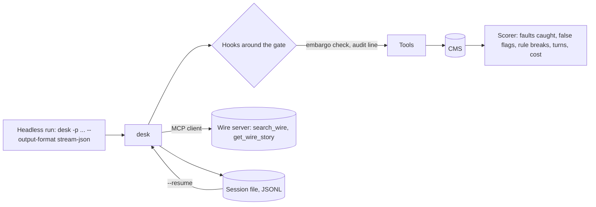

# Extend and ship

## The problem

The night editor wants desk to run with nobody watching, before the website updates. That changes the job. No
one can answer a permission prompt, so the run must deny instead of hang, and say so in an exit code a script
reads. A crash halfway must resume without filing a story twice. Every tool call must leave an audit line.
Wire stories arrive from a news agency server, not a folder. And before the editor trusts it, desk needs a score
on the planted faults, next to a real harness run on the same drafts.

## Why it matters

Newsrooms already run agents this way. Katadata's news analysis system "scales to process over 10,000 articles
daily", and analysis time fell "from 3 hours to 15 minutes"
([Google Cloud customer story, read today](https://cloud.google.com/customers/katadata)). FUNKE Mediengruppe
runs its tools through "a central registry on the Model Context Protocol with more than 20 MCP servers",
including one for Germany's national news agency
([Google Cloud customer story, read today](https://cloud.google.com/customers/funkemediengruppe)). Both are
vendor case studies; the numbers are the companies' claims as published there.



## Steps

| Step | Minutes | You build | The check reads |
|---|---|---|---|
| `add-hooks` | 20 | `pre_tool` and `post_tool` hooks run as shell commands from config; exit 2 blocks with a reason | The CMS after an embargoed filing (refused by the hook), the audit JSONL (one line per call), a hung hook killed after 10 seconds |
| `connect-a-wire-server` | 20 | An MCP client over stdio with `@modelcontextprotocol/client`; wire tools appear as `wire__search_wire` | The tool list in the recorded request, the wire server's own call log, an error result when the server dies |
| `resume-a-session` | 15 | An append-only JSONL session file, `--resume <id>` and `--continue` | The first request after a resume (history equal to the saved one), the CMS after a stopped and resumed run (no story filed twice) |
| `run-headless` | 15 | `-p` with `--output-format text`, `json` and `stream-json`, and the exit codes | Every stdout line against `checks/lib/contract.schema.json`, exit codes 0, 1, 3 and 4 |
| `score-the-agent` | 25 | `bun run score` over the 12 drafts: faults caught, false flags, rule breaks, turns, cost | The scorer's JSON against the answer key, `notes/failures.md` with a session line per missed fault |
| `rebuild-on-the-agent-sdk` (deeper) | 30 | `desk-sdk/`: the same tools under the Claude Agent SDK | The same contract run and score, and `notes/sdk-compare.md` with its four headings |

Minutes in this part: 125, of which 30 are the deeper step.

## Walkthrough

TODO(part session): write the step folders, then replace this block with one `bun run verify <step-name>`
command per step, each with its Expect line.

```bash
bun run verify part extend-and-ship
```

Expect: TODO(part session). Until the steps exist it prints `0/0 steps pass`.

## Read

- [MCP TypeScript SDK README](https://raw.githubusercontent.com/modelcontextprotocol/typescript-sdk/main/README.md)
- [Scaling Managed Agents: decoupling the brain from the hands](https://www.anthropic.com/research/managed-agents)
- [Demystifying evals for AI agents](https://www.anthropic.com/research/demystifying-evals-for-ai-agents)
