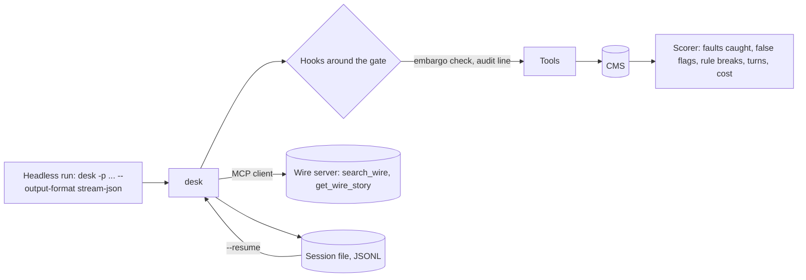

# Extend and ship

## After this part you can

- Block a tool call with a hook that runs before it.
- Connect an outside tool server over MCP.
- Resume a stopped run from its session file.
- Run desk headless and read its exit code.
- Score the agent on planted faults.

## You leave with

desk is now a harness you can ship. Hooks guard the tools, a wire service plugs in over MCP, and a stopped run
carries on where it was. A script can read every event and every exit code. And a score says how good it is,
read from the CMS, not from the agent's own words. You built every part of it, from one model call in part
one to a scored night run here.

## The problem

The night editor wants desk to run with nobody watching, before the website updates. A run like that is called
headless. It changes the job in five ways:

- No one can answer a permission prompt. So the run must deny the tool, not wait forever. It must also say so
  with an exit code that a script can read. An exit code is the number a program returns when it ends.
- After a crash in the middle, desk must pick up again without filing a story twice.
- Every tool call must leave an audit line, a record of the call in a log file.
- Wire stories come from the server of a news agency, not from a folder.
- Before the editor trusts desk, it needs a score on the planted faults. That score sits next to the score of a
  real harness on the same drafts.

For example, the finished desk can print one line of JSON at the end of a run. A script can read it:

```text
{"type":"result","subtype":"success","turns":46,"cost_usd":0.425663,"session_id":"fb702246","text":"Tonight's drafts are done. Filed 9, held 3, logged 7 corrections. The held stories need the night editor.","events":204}
```

You get this line from `bun run demo --output-format json`. The `subtype` says how the run ended. The
`session_id` lets you resume the run later.

## Why it matters

Newsrooms already run agents this way. Katadata's news analysis system "scales to process over 10,000 articles
daily". Its analysis time fell sharply
([Google Cloud customer story](https://cloud.google.com/customers/katadata)).

FUNKE Mediengruppe runs its tools through "a central registry on the Model Context Protocol with more than 20
MCP servers". The Model Context Protocol, or MCP, is a standard way to plug outside tools into an agent. One of
those servers is for Germany's national news agency
([Google Cloud customer story](https://cloud.google.com/customers/funkemediengruppe)).

Both stories come from a company that sells to these newsrooms. The numbers are the claims of the newsrooms, as
that company published them.



## Steps

| Step                    | Minutes | You build                                                                                              | The check reads                                                                                                                   |
| ----------------------- | ------- | ------------------------------------------------------------------------------------------------------ | --------------------------------------------------------------------------------------------------------------------------------- |
| `add-hooks`             | 20      | `pre_tool` and `post_tool` hooks run as shell commands from config; exit 2 blocks with a reason        | The CMS after an embargoed filing (refused by the hook), the audit JSONL (one line per call), a hung hook killed after 10 seconds |
| `connect-a-wire-server` | 20      | An MCP client over stdio with `@modelcontextprotocol/client`; wire tools appear as `wire__search_wire` | The tool list in the recorded request, the wire server's own call log, an error result when the server dies                       |
| `resume-a-session`      | 15      | An append-only JSONL session file, `--resume <id>` and `--continue`                                    | The first request after a resume (history equal to the saved one), the CMS after a stopped and resumed run (no story filed twice) |
| `run-headless`          | 15      | `-p` with `--output-format text`, `json` and `stream-json`, and the exit codes                         | Every stdout line against `checks/lib/contract.schema.json`, exit codes 0, 1, 3 and 4                                             |
| `score-the-agent`       | 25      | `bun run score` over the 12 drafts: faults caught, false flags, rule breaks, turns, cost               | The scorer's JSON against the answer key, `notes/failures.md` with a session line per missed fault                                |

This part fits in an evening. A deeper step that rebuilds desk on the Claude Agent SDK is not in the repo yet.

Every step starts from `problem/src/`. The first step starts from your Keep the context clean desk, with three new files
left empty until their step: `src/wire.ts`, `src/session.ts` and `src/output.ts`.

## Walkthrough

Here is the whole part from start to finish. Each check runs your desk three times on the practice model, in a
fresh newsroom with its own CMS. Then it reads the CMS, the files desk wrote, and the exit codes.

```bash
bun run verify add-hooks
```

Expect: `Done. All 4 rules pass.` once the embargo hook blocks a filing and the audit hook logs every call.

```bash
bun run verify connect-a-wire-server
```

Expect: `Done. All 4 rules pass.` once the wire tools come from the MCP server and pass the same gate.

```bash
bun run verify resume-a-session
```

Expect: `Done. All 4 rules pass.` once a stopped run carries on with `--resume` and files nothing twice.

```bash
bun run verify run-headless
```

Expect: `Done. All 5 rules pass.` once every stream-json line fits the contract and the exit codes are right.

```bash
bun run score
```

Expect: a JSON score. On the starter of `score-the-agent` it shows `"caught": 6`.

```bash
bun run verify score-the-agent
```

Expect: `Done. All 3 rules pass.` once desk catches all 13 faults and `notes/failures.md` explains the misses.

```bash
bun run verify part extend-and-ship
```

Expect: `Part extend-and-ship is done: 5/5 steps pass.`

## Watch and read

- [MCP TypeScript SDK README](https://raw.githubusercontent.com/modelcontextprotocol/typescript-sdk/main/README.md)
- [Scaling Managed Agents: decoupling the brain from the hands](https://www.anthropic.com/research/managed-agents)
- [Demystifying evals for AI agents](https://www.anthropic.com/research/demystifying-evals-for-ai-agents)

## Project

The problem: the editor wants the run to happen with nobody watching, survive a crash, leave an audit trail,
and prove it is good enough.

Hand in your `src/` folder with hooks, the MCP client, sessions and headless mode, and `notes/failures.md`.
Then add `scorecard.md`: one table with your desk's score from `bun run score`, and a second column for a
real harness on the same drafts. For example, run the same 12 drafts with `claude -p` and score the CMS.

| Question (yes or no)                                                 | How it is checked                     |
| -------------------------------------------------------------------- | ------------------------------------- |
| Does `bun run verify part extend-and-ship` pass?                     | The verifier                          |
| Does the score catch 13 of 13 faults on the practice model?          | `bun run score`                       |
| Are there zero false flags and zero rule breaks?                     | `bun run score`                       |
| Does `notes/failures.md` name each missed fault with a session line? | A rule of the `score-the-agent` check |
| Does `scorecard.md` have a second column for a real harness?         | A heading and a row in the file       |
