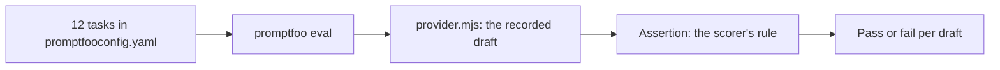

# Score with promptfoo

## The problem

`bun run score` tells you how many faults desk caught. Your team wants the same answer from a shared tool.

For example, the task `bridge-repairs` must come back filed, with `£420,000` in the text and a correction
logged for `£4.2m`.



## Watch it done

promptfoo is an open-source eval runner. It reads one YAML file of tasks and assertions, runs each task, and
prints a table of passes and fails.

Your desk already ran headless over the 12 drafts. That run is saved in `assignment/recorded.json`, so the eval
needs no key. A small provider file hands one draft at a time to promptfoo. A provider is the code that
returns the output for a task.

## Your turn

Work in the `assignment/` folder. The steps below use the sample answer's names, so you can compare.

1. Open `assignment/promptfooconfig.yaml`. It has one task and no assertion. Add one task for each draft in
   `world/seed/answer-key.json`. Give each task a `slug`, the `status` it must end with, and its `fixes`.
2. Write the assertion in `assignment/caught.mjs`. Copy the rule from `score.ts`: a held story is held, and a
   filed story has the right text, loses the wrong text, and logs a correction when one is needed.

## Do it on your work

3. Run the eval:

```bash
npx promptfoo@0.125.1 eval -c assignment/promptfooconfig.yaml
```

Expect: a table with 12 rows and `12 passed (100%)` once your tasks and assertion are right.

4. Run the check:

```bash
bun run assignment
```

Expect: three `PASS` lines, `Every line passes.`, and a new `assignment/result.json`.

## Done when

- promptfoo reports the pinned version.
- Every course task has at least one assertion.
- The run exits zero when the desk passes the bar you set. Its pass count matches the hand-built score.

## Solution

The sample answer is in `solution/`.

## If you get stuck

- Run `bun run score` and count the drafts with no missed fault. Your pass count must be the same number.
- A task with no `assert` still needs one. Share an assertion through `defaultTest`, as the sample does.
- Copy the shape of `solution/promptfooconfig.yaml` for a draft with two fixes.
- The run needs no key. If it asks for one, check that `providers` points at `provider.mjs`.

## Words you will use

- **Eval runner**: a tool that runs a set of tasks and reports passes and fails.
- **Provider**: the code that returns the output for one task.
- **Assertion**: a rule that an output must meet to pass.
- **Recording**: the saved output of a desk run, so the eval repeats without a model.
