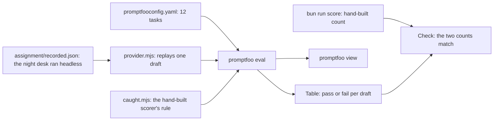

# Score the desk with promptfoo

## After this part you can

- Turn the 12 drafts into promptfoo tasks.
- Write the hand-built scorer's rule as one assertion.
- Read the pass and fail table, and open it with `promptfoo view`.
- Prove that the new count equals the old one.

## You leave with

Your eval runs without a key, and its count equals your hand-built score. The hand-built scorer taught you the
rule. promptfoo is how a team runs that rule every day.

## The problem

You built a scorer by hand in `score-the-agent`. It runs desk on tonight's 12 drafts, reads the CMS, and
counts the faults caught. It works. But a team that ships an agent does not keep a private scorer. They use a
shared eval tool, so every engineer reads the same table and CI can fail a bad change.

An eval is a repeatable test of a model or an agent. An eval runner runs it for you and prints a table of passes
and fails.

For example, your scorer prints one JSON score. An eval runner prints one row per draft: `bridge-repairs`
passes, `shop-break-in` passes, and any draft that fails shows the reason.

## Why it matters

A hand-built scorer teaches you what to measure. A shared runner makes that measure part of the team's daily
work. The rule in your scorer does not change. Only the place it runs changes.

promptfoo is an open-source eval runner. You describe the tasks and the assertions in one YAML file. An
assertion is a rule that a result must meet. The runner executes every task, prints a table, and exits with a
code that CI can read.



## What we teach

- How to turn the 12 drafts into 12 promptfoo tasks.
- How to write the hand-built scorer's rule as one assertion.
- How to read the pass and fail table and open it with `promptfoo view`.
- How to prove the new count equals the old one.

## Steps

| Step                   | Minutes | You build                                                             | The check reads                                                                          |
| ---------------------- | ------- | --------------------------------------------------------------------- | ---------------------------------------------------------------------------------------- |
| `score-with-promptfoo` | 25      | A `promptfooconfig.yaml` with a task and an assertion for every draft | The pinned version, an assertion on every task, and a pass count equal to the hand score |

This part is optional in the live session. It is expected as homework. The work lives in the
[assignment folder](../../assignment/README.md), and the sample answer is in the step's `solution/` folder.
No Docker container is needed.

## Walkthrough

Run the sample answer first, so you see what the finished table looks like. Run these from the repo root.

```bash
npx promptfoo@0.125.1 eval -c parts/05-score-the-desk-with-promptfoo/01-score-with-promptfoo/solution/promptfooconfig.yaml
```

Expect: a table with one row per draft, then `12 passed (100%)` and `0 failed (0%)`.

```bash
npx promptfoo@0.125.1 view
```

Expect: a page at `http://localhost:15500` that shows the same table. Press Ctrl+C to stop it.

```bash
bun run verify score-with-promptfoo solution
```

Expect: `Done. All 3 rules pass.`

```bash
bun run assignment
```

Expect: on the starter, three lines that start with `PASS` or `FAIL`, then `assignment/result.json` is written. It passes all three once you finish the task.

## Options

**promptfoo or Inspect AI.** promptfoo is the pick here.

Choose Inspect AI when your scorers are Python, or when you want a dataset, a solver and a scorer in plain
Python code.

Trade-off: Inspect AI needs a Python setup inside a TypeScript repo. promptfoo runs from `npx` with one YAML
file.

## Watch and read

- [promptfoo documentation](https://www.promptfoo.dev/docs/intro/)
- [Inspect AI](https://inspect.aisi.org.uk/)

## Project

In `CHOICE.md`, write which one you would pick for your own team and why.
