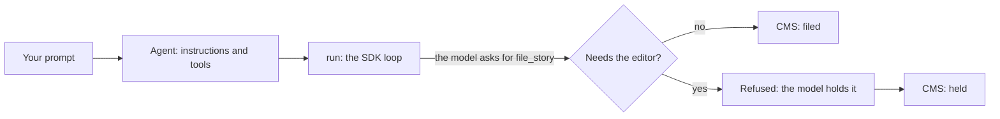

# Run the desk with the OpenAI Agents SDK

## The problem

Tonight's 12 drafts must be filed or held before the 06:00 website update. Your hand-built loop
does the work, but you wrote every part of it: the messages, the tool results and the approval step.
A team that does not want to own a loop uses a framework instead.



## Watch it done

The OpenAI Agents SDK runs the loop for you. You describe the agent, its tools and its approvals.

The risk is that the framework files a story the rules say to hold. For example, a draft with an
embargo that has not passed must wait for the night editor. An approval step stops that filing.

## Your turn

Open `src/main.ts`. It stops with a TODO message. Build the desk on the SDK.

1. Create one `Agent` with the desk's instructions. Read `DESK.md` and `drafts/DESK.md` into them, as
   the finished desk does. Do not type the rules again by hand.
2. Define each tool with `tool()` and a zod schema. Give `file_story` a `needsApproval` function. It
   answers from the drafts and sources, so a held draft waits for the night editor.
3. Point the SDK at the practice model. Turn tracing off, use the chat completions API and build an
   OpenAI client with the practice model's address. No call may leave the machine.
4. Call `run()`. When a filing waits for approval, refuse it, then run again. The model holds the story.

Start the practice model in one terminal, then check your work in a second terminal:

```bash
bun run practice-model
```

Expect: `The practice model is running at http://localhost:4010.` Leave it running.

## Do it on your work

```bash
bun run verify run-the-desk-with-the-openai-agents-sdk
```

Expect: "0 of 5" until you finish, then `Done. All 5 rules pass.`

## Done when

- The desk files 9 stories and holds 3 on the practice model, and the last line shows those counts.
- Held stories stop at approval, not in the instructions text.
- Removing `needsApproval` would make the check fail.

## Solution

The sample answer is in `solution/`.

## If you get stuck

| What you see                                                           | Fix                                                                                                    |
| ---------------------------------------------------------------------- | ------------------------------------------------------------------------------------------------------ |
| `FAIL The desk makes at least four model requests`                     | Make sure the practice model is running, then send tool results back. `run()` loops for you.           |
| `FAIL A held story stops at approval`                                  | Add `needsApproval` to `file_story`. Return `true` for a draft with an embargo, no source, or a minor. |
| `FAIL The desk files the 9 clean stories and holds the 3 held stories` | Check the approval function on a clean draft. It should return `false` when the draft has a source.    |
| `FAIL The desk reads the planted line`                                 | Give the agent `read_file`, and check that its result reaches the next request.                        |

## Words you will use

- **Agent**: the SDK's name for a model with instructions and tools.
- **Tool**: a function the model can ask for. You give it a name, a schema and a function to run.
- **Approval**: a pause before a tool runs. The SDK stops and waits for a yes or a no.
- **Practice model**: a stand-in model on your machine. It gives the same answers every run.
