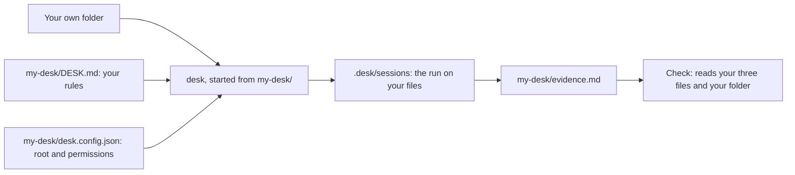

# Point desk at your own files

## The problem

Everything so far ran on the Millbrook newsroom. That folder is made up, so it proves little. The real test is a
folder you care about: your notes, your recipes, your reports.

desk only needs three things from you. A rules file that names your real files, a permission file that fences it
in, and proof from one real run.

## Watch it done

For example, take a home folder with `notes/trip-plan.md` and two recipes. It needs a rule such as "every date
in the trip plan must match the ferry tickets". A rule that names no real file cannot be checked.



## Your turn

The three starter files are in `my-desk/`. Fill them in. The check reads them and your folder. It never reads the
course world, and it refuses a folder that belongs to this course.

1. Pick a small folder of your own with at least three files. Copy it if you want to keep the original safe.
2. In `my-desk/desk.config.json`, set `root` to its path. Put `read_file` in `allow`. Put at least one tool that
   changes things, such as `run_command`, in `deny`.
3. In `my-desk/DESK.md`, fill in the three sections. In "Check before filing", name two or more of your real
   files in backticks.
4. Start desk from your folder and ask it to check the files against your rules. Use the same `-p` flag as before.
5. Open the newest file in `.desk/sessions/`. Copy one line where desk read one of your files into
   `my-desk/evidence.md`, in a json block.
6. Under "What it found", write two or three sentences about what desk found or got wrong.

## Do it on your work

```bash
bun run verify point-desk-at-your-own-files
```

Expect: `Done. All 5 rules pass.`

## Done when

- `desk.config.json` names your own folder, with at least 3 files, outside the course world.
- It denies at least one tool that changes things, and allows reading.
- `DESK.md` has the three rule sections, each filled in, and names real files of yours.
- `evidence.md` pastes a session line where desk read one of your files.
- `evidence.md` says in your own words what desk found, in at least 20 words.

## Solution

The sample answer is in `solution/`.

## If you get stuck

| What you see                                     | Fix                                                                         |
| ------------------------------------------------ | --------------------------------------------------------------------------- |
| `FAIL  my-desk/desk.config.json names ...`       | The `root` path must exist and hold three files. It is not a course folder. |
| `FAIL  my-desk/DESK.md has the three ...`        | Remove every `TODO`. Name two real files in backticks.                      |
| `FAIL  my-desk/evidence.md pastes a session ...` | Copy a whole line, and make sure its `path` is a file in your folder.       |

## Words you will use

- **Root**: the folder desk is allowed to work in.
- **Evidence**: a saved line from a real run, so a reader can see what desk did without asking you.
- **Session file**: the saved record of one run, one JSON line for each message.
