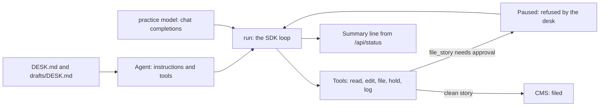

# Run the desk with the OpenAI Agents SDK

## After this part you can

- Describe a desk as one `Agent` with instructions and tools.
- Write a tool with `tool()` and a zod schema.
- Pause a filing with `needsApproval`, and refuse it when no editor is there.
- Point the SDK at the practice model, with no call that leaves the machine.

## You leave with

The desk runs on a framework and files the same 9 stories. It holds the same 3, and it refuses to file a
held story, whatever the model asks. You did not write the loop. You wrote the rule that stops the filing.

This step proves the wiring. It shows that the SDK runs the tool loop and that the approval holds a
story. It does not prove the quality of a real OpenAI model's choices. The practice model answers the same
way every run. Tracing, handoffs, guardrails, sessions and the Realtime package are not taught here.

## The problem

Your desk loop works. You wrote it by hand in `run-the-loop` and `touch-the-world-safely`. It sends
messages, reads tool results and stops at the right moments. But every line of it is yours to keep up.
When a new tool arrives, you change the loop. When a new approval rule arrives, you change the loop again.

A team that ships an agent often does not want to own that loop. They use a framework. The framework runs
the loop, keeps the run's state and pauses for approvals. The team describes the agent and its tools.

For example, the desk's `file_story` tool can pause before it files a story. The framework stops, asks for
a decision, and resumes with the answer. Your code only says which stories need the night editor.

## Why it matters

A framework saves code. It can also file a story the rules say to hold, if nobody tells it when to stop.
The rule in the desk does not change. Only the place it lives changes. It moves from your loop into an
approval on one tool.

The OpenAI Agents SDK is an open-source package. Its `Agent` holds the instructions and the tools. Its
`run()` function runs the loop. Its `needsApproval` option pauses a tool before it runs.



## What we teach

- How to describe a desk as one `Agent` with instructions and tools.
- How to write a tool with `tool()` and a zod schema.
- How to pause a filing with `needsApproval`, and refuse it when no editor is there.
- How to point the SDK at the practice model, with no call that leaves the machine.

## Steps

| Step                                      | Minutes | You build                                                        | The check reads                                                                                  |
| ----------------------------------------- | ------- | ---------------------------------------------------------------- | ------------------------------------------------------------------------------------------------ |
| `run-the-desk-with-the-openai-agents-sdk` | 25      | An `Agent` with tools, a `needsApproval` rule and a `run()` loop | The desk files 9 and holds 3, a held story stops at approval, and the last line shows the counts |

| `point-desk-at-your-own-files` | 15 | A rules file, a permission file and a run record for a folder of your own | Your three files and your own folder, never the course world |

The step's starter is in the [step folder](01-run-the-desk-with-the-openai-agents-sdk/problem/README.md).
The sample answer is in its `solution/` folder. No key is needed, and no Docker container is needed.

## Walkthrough

Run the sample answer first, so you see the finished result. Run these from the repo root.

```bash
bun run verify run-the-desk-with-the-openai-agents-sdk solution
```

Expect: `Done. All 5 rules pass.` The check runs the sample answer three times, with fresh data each time.

```bash
bun run verify run-the-desk-with-the-openai-agents-sdk
```

Expect: "0 of 5" on the starter, with a try-next line under each FAIL. Finish the step to see
it change.

```bash
bun run demo
```

Expect: `Filed 9, held 3, waiting 0. Corrections logged tonight: 7. Rule breaks: 0.` This is the finished
desk, the hand-built loop. The SDK version must print the same line.

## Options

**OpenAI Agents SDK or the Vercel AI SDK `ToolLoopAgent`.** The Agents SDK is the pick for this desk.

Choose the Vercel AI SDK `ToolLoopAgent` when your code already uses the `ai` package, or when you need
one loop over many providers. It adds no new package to the repo.

Trade-off: the Agents SDK gives approvals and run state for free. Its tool shapes and its client are its
own. The Vercel loop adds no package, but you write the approval step yourself.

## Watch and read

- [@openai/agents on npm](https://www.npmjs.com/package/@openai/agents)

## Project

Do the second step on a folder of your own. It ends with three files and a run record from your own folder.
